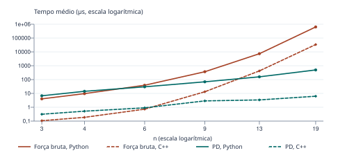

# Subconjunto soma (Subset Sum)

**Teoria da Computa��o � Equipe 4 � Prof. Daniel Bezerra**

Israel Erlich, Lu�s Augusto, Theo Moura e Guilherme Rabelo  
Apresenta��o em 30/11/2026

O problema de decis�o recebe uma lista de inteiros n�o negativos e um alvo e responde se alguma sele��o de posi��es soma exatamente o alvo. Cada posi��o pode ser usada uma vez. Valores repetidos representam posi��es distintas e o subconjunto vazio soma zero.

| Algoritmo | Python | C++ | Tempo no pior caso | Espa�o auxiliar |
| --- | --- | --- | --- | --- |
| For�a bruta por m�scaras | `src/subset_sum.py` | `src/subset_sum.cpp` | �(n � 2n) | �(n + 1) |
| Programa��o din�mica em uma dimens�o | `src/subset_sum.py` | `src/subset_sum.cpp` | �((n + 1)(S + 1)) | �(S + 1) |

Em for�a bruta com solu��o na primeira m�scara poss�vel, o melhor caso custa �(n + 1). A programa��o din�mica visita toda a faixa de somas para cada item. Sua depend�ncia do valor num�rico de S caracteriza tempo pseudopolinomial.

## Reprodu��o

Use Python 3.10 ou superior e GCC/G++ com suporte a C++17 no PATH. Para usar outro execut�vel G++, passe `--cxx caminho` aos scripts que compilam.

```bash
python -m pip install -r requirements.txt
python tests/testar.py
python scripts/medir.py
python scripts/variar_alvo.py
python scripts/analisar.py
python scripts/limite.py
```

O teste usa 172 entradas com respostas de um or�culo por combina��es e compara as quatro implementa��es. O benchmark principal compila C++, gera `dados/entradas.tsv`, registra o ambiente e verifica todas as respostas com um or�culo independente. Para gerar s� o TSV, rode `python scripts/gerar_entradas.py`. A busca da fronteira de 60 segundos se baseia nas medi��es principais e pode levar alguns minutos.

### Execu��o avulsa

```bash
python src/executar.py dados/entradas.tsv python.csv ambos
g++ -std=c++17 -O2 -DNDEBUG -Wall -Wextra -pedantic src/subset_sum.cpp -o subset_sum
./subset_sum dados/entradas.tsv cpp.csv ambos
```

No PowerShell, compile com `-o subset_sum.exe` e execute `./subset_sum.exe`. A �ltima op��o pode ser `forca_bruta`, `pd` ou `ambos`. A sa�da inclui o identificador do caso, o algoritmo, a repeti��o, a resposta (0 ou 1) e a dura��o em nanossegundos. O formato TSV usa as colunas `caso`, `cenario`, `n`, `alvo`, `repeticoes` e `valores`. A �ltima coluna cont�m os valores separados por espa�o e fica vazia quando n = 0. A interface comum exige que a soma dos valores caiba em 63 bits n�o negativos e que a tabela caiba na mem�ria dispon�vel quando a PD for executada.

### Experimento

- Seis tamanhos em progress�o aproximadamente geom�trica, com n = 3, 4, 6, 9, 13, 19 e S = 20n + 1.
- Um caso de melhor e um de pior caso da for�a bruta para cada n, ambos executados 15 vezes. As mesmas 15 entradas aleat�rias por n s�o executadas uma vez por implementa��o. A semente principal � 20261123.
- A medi��o cobre a chamada de cada algoritmo, incluindo aloca��o das estruturas auxiliares. Cada execu��o l� o lote antes do cron�metro, faz cinco rodadas curtas por algoritmo e grava a resposta ap�s a medi��o.
- `variar_alvo.py` mant�m n = 13 e a lista fixa, alternando entre oito alvos �mpares. Isso isola o efeito de S.
- `limite.py` consulta uma fam�lia de pior caso definida pelo mesmo prefixo de valores pares. Faz uma sondagem por n, marca tempos acima de 60 s e interrompe processos que superem 61,5 s de rel�gio externo.

## Resultados

| Arquivo | Conte�do |
| --- | --- |
| `resultados/ambiente.json` | Hardware, sistema, vers�es, flags e rel�gios |
| `resultados/medicoes_*.csv` | 1.080 leituras do experimento principal |
| `resultados/alvo_*.csv` | 480 leituras com n fixo |
| `resultados/resumo.csv` e `resultados/resumo_alvo.csv` | M�dias e desvios padr�o amostrais em nanossegundos |
| `resultados/limite.csv` | Maior n observado dentro do or�amento em cada linguagem e sondagens vizinhas |
| `resultados/graficos/*.svg` | Compara��es do tempo, da curva te�rica e da varia��o de S |



## Refer�ncias

- BEZERRA, Daniel. *Teoria da Computa��o - Projeto de Complexidade*. Enunciado, 2026.
- MIT OpenCourseWare. *6.006 Introduction to Algorithms. Lecture 18: Pseudopolynomial*. 2020. [Notas de aula](https://ocw.mit.edu/courses/6-006-introduction-to-algorithms-spring-2020/f62798df9d8020e1c92130bd76a26f20_MIT6_006S20_lec18.pdf).
- MIT OpenCourseWare. *6.006 Introduction to Algorithms. Lecture 19: Complexity*. 2020. [Notas de aula](https://ocw.mit.edu/courses/6-006-introduction-to-algorithms-spring-2020/fda666a4db1dc65b3d71be08115502bd_MIT6_006S20_lec19.pdf).
- KARP, Richard M. *Reducibility Among Combinatorial Problems*. 1972, p. 85-103. [DOI](https://doi.org/10.1007/978-1-4684-2001-2_9).
