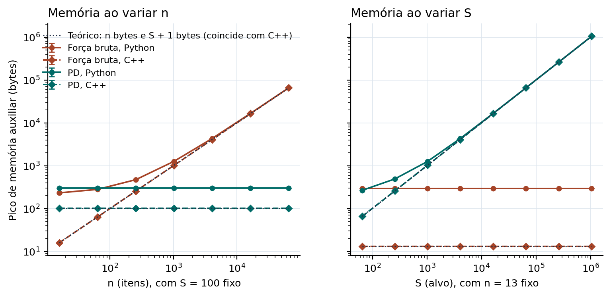

# 1. Descrição do problema e dos algoritmos

O problema sorteado para a Equipe 4 é o **Subconjunto Soma** (*Subset Sum*), em sua versão de decisão sobre inteiros não negativos (BEZERRA, 2026).

## Definição formal

**Entrada:** uma lista $V = (v_0, v_1, \dots, v_{n-1})$ de $n \ge 0$ inteiros não negativos ($v_i \in \mathbb{Z}_{\ge 0}$) e um alvo $S \in \mathbb{Z}_{\ge 0}$.

**Saída:** `SIM` se existir um subconjunto de índices $I \subseteq \{0, 1, \dots, n - 1\}$ tal que $\sum_{i \in I} v_i = S$, ou `NÃO` caso contrário.

Cada posição da lista pode ser usada no máximo uma vez. Valores repetidos ocupam índices distintos e contam como elementos separados (por exemplo, $V = [5, 5]$ e $S = 10$ tem resposta `SIM` via $I = \{0, 1\}$). O subconjunto vazio ($I = \emptyset$) tem soma $0$, logo toda instância com $S = 0$ tem resposta `SIM`, inclusive quando $n = 0$.

## Lógica geral e pseudocódigo

Ambos os algoritmos foram implementados em Python (CPython) e C++17 (`src/subset_sum.py` e `src/subset_sum.cpp`), preservando a mesma lógica e ordem de operações.

### Algoritmo A: Força bruta por máscaras binárias

Cada subconjunto de índices é representado por um vetor binário `mascara` de tamanho $n$, com bit menos significativo na posição $0$. A máscara inicia zerada e avança como um contador binário. Para cada máscara visitada, o algoritmo percorre todas as $n$ posições para recalcular a soma dos itens marcados; se a soma igualar $S$, retorna `SIM`. No incremento, zeram-se os bits iniciais iguais a $1$ até encontrar o primeiro bit $0$, trocando-o para $1$; quando todos os $n$ bits são $1$ ($i = n$), todas as $2^n$ máscaras foram testadas sem sucesso e retorna-se `NÃO`.

```text
algoritmo ForcaBruta(valores, alvo):
    n <- tamanho(valores)
    mascara <- vetor de n bytes inicializado com 0

    repita:
        soma <- 0
        para i de 0 ate n - 1:
            se mascara[i] == 1 entao:
                soma <- soma + valores[i]
        se soma == alvo entao:
            retorne SIM

        i <- 0
        enquanto i < n e mascara[i] == 1:
            mascara[i] <- 0
            i <- i + 1
        se i == n entao:
            retorne NAO
        mascara[i] <- 1
```

### Algoritmo B: Programação dinâmica unidimensional

A programação dinâmica (PD) mantém um vetor booleano `alcancavel` de tamanho $S + 1$, inicializado com `falso`, exceto `alcancavel[0] = verdadeiro`. Após processar os $i$ primeiros itens, `alcancavel[s]` indica se existe um subconjunto desses itens com soma $s$. Para cada item `valor`, o laço interno percorre `soma` em ordem decrescente de $S$ até $0$, atualizando `alcancavel[soma]` para `verdadeiro` sempre que `soma >= valor` e `alcancavel[soma - valor]` já for `verdadeiro`. Apenas posições entre $S$ e `valor` podem mudar, mas percorrer até $0$ com a guarda `soma >= valor` corresponde diretamente ao código em Python e C++ e mantém o número de iterações fixo em $S + 1$ por item. Ao final, retorna-se `SIM` se `alcancavel[alvo]` for `verdadeiro`.

```text
algoritmo ProgramacaoDinamica(valores, alvo):
    alcancavel <- vetor booleano de tamanho alvo + 1, inicializado com falso
    alcancavel[0] <- verdadeiro

    para cada valor em valores:
        para soma de alvo ate 0 passo -1:
            se soma >= valor e alcancavel[soma - valor] entao:
                alcancavel[soma] <- verdadeiro

    se alcancavel[alvo] for verdadeiro entao:
        retorne SIM
    senao:
        retorne NAO
```

### Por que a atualização decrescente é obrigatória

Como o vetor `alcancavel` é atualizado no local (*in-place*), percorrer `soma` de $S$ até $0$ assegura que, ao ler `alcancavel[soma - valor]` (com `valor > 0`), essa posição ainda guarde o estado anterior ao item atual, impedindo sua reutilização. Considere $V = [4]$ e $S = 8$, cuja resposta correta é `NÃO`:

- **Ordem decrescente (correta):** ao processar $4$, testa-se $s = 8$ antes de $s = 4$. Como `alcancavel[8 - 4] = alcancavel[4]` ainda é `falso`, `alcancavel[8]` permanece `falso`. Depois, em $s = 4$, `alcancavel[0]` é `verdadeiro` e marca-se `alcancavel[4] = verdadeiro`. Resultado: `NÃO`.
- **Ordem crescente (incorreta):** em $s = 4$, marcaria `alcancavel[4] = verdadeiro` usando o item $4$; na mesma passagem, em $s = 8$, leria esse novo valor e marcaria `alcancavel[8] = verdadeiro`, reutilizando o item duas vezes ($4 + 4 = 8$).

## Exemplo resolvido à mão

Seja $V = [3, 5, 9, 12]$ ($n = 4$) e alvo $S = 14$. A resposta é `SIM`, obtida por $v_1 + v_2 = 5 + 9 = 14$.

**Força bruta:** com `mascara[0]` associado a $3$, `mascara[1]` a $5$, `mascara[2]` a $9$ e `mascara[3]` a $12$, o contador visita $7$ das $2^4 = 16$ máscaras até parar:

| Passo | Máscara `[m0, m1, m2, m3]` | Subconjunto | Soma | Ação |
| :---: | :---: | :---: | :---: | --- |
| 1 | `[0, 0, 0, 0]` | $\emptyset$ | 0 | $0 \neq 14$; incrementa |
| 2 | `[1, 0, 0, 0]` | $\{3\}$ | 3 | $3 \neq 14$; incrementa |
| 3 | `[0, 1, 0, 0]` | $\{5\}$ | 5 | $5 \neq 14$; incrementa |
| 4 | `[1, 1, 0, 0]` | $\{3, 5\}$ | 8 | $8 \neq 14$; incrementa |
| 5 | `[0, 0, 1, 0]` | $\{9\}$ | 9 | $9 \neq 14$; incrementa |
| 6 | `[1, 0, 1, 0]` | $\{3, 9\}$ | 12 | $12 \neq 14$; incrementa |
| 7 | `[0, 1, 1, 0]` | $\{5, 9\}$ | 14 | $14 = 14$; retorna `SIM` |

**Programação dinâmica:** o vetor `alcancavel[0..14]` evolui item a item conforme abaixo (somas acima de $14$ ficam fora da tabela):

| Etapa | Novas marcas (ordem decrescente) | Índices verdadeiros em `alcancavel` |
| --- | --- | --- |
| Inicial | $s = 0$ | $\{0\}$ |
| $v_0 = 3$ | $s = 3$ (de $0$) | $\{0, 3\}$ |
| $v_1 = 5$ | $s = 8$ (de $3$), $s = 5$ (de $0$) | $\{0, 3, 5, 8\}$ |
| $v_2 = 9$ | $s = 14$ (de $5$), $s = 12$ (de $3$), $s = 9$ (de $0$) | $\{0, 3, 5, 8, 9, 12, 14\}$ |
| $v_3 = 12$ | nenhuma nova ($s = 12$ já verdadeiro) | $\{0, 3, 5, 8, 9, 12, 14\}$ |

Ao término do laço externo, `alcancavel[14]` é `verdadeiro` e o algoritmo retorna `SIM`. Note que, mesmo marcando $14$ no item $9$, a PD ainda processa o item $12$.

# 2. Classificação assintótica

Adota-se o modelo RAM de custo unitário, assumindo que valores, somas e índices cabem em uma palavra de máquina (operações aritméticas e acessos a memória em tempo $O(1)$). As expressões assintóticas principais assumem $n \ge 1$ e $S \ge 1$ (no caso $n = 0$, a força bruta custa $\Theta(1)$ e a PD custa $\Theta(S + 1)$).

## Algoritmo A: Força bruta

### Contagem de operações

A alocação e inicialização de `mascara` custam $\Theta(n)$. Suponha que o algoritmo visite $m$ máscaras até encerrar ($1 \le m \le 2^n$):

- **Varredura por máscara:** o laço interno percorre todas as $n$ posições de `mascara`, executando $n$ testes, entre $0$ e $n$ somas e uma comparação com `alvo`. Logo, cada máscara visitada custa $\Theta(n)$ operações, totalizando $\Theta(m \cdot n)$.
- **Incrementos do contador binário:** se uma solução é encontrada após visitar $m$ máscaras, ocorrem $k = m - 1$ avanços do contador; se não há solução, ocorrem $k = 2^n = m$ tentativas de avanço, sendo que a última zera a máscara e detecta o estouro ($i = n$). Um único avanço custa $O(n)$ no pior passo (todos os bits iguais a $1$). Contudo, ao longo de $k$ avanços a partir de zero, o bit $j$ ($0 \le j < n$) é alterado exatamente $\lfloor k / 2^j \rfloor$ vezes. O total de inversões de bits em $k$ avanços é:

$$\sum_{j=0}^{n-1} \left\lfloor \frac{k}{2^j} \right\rfloor \le \sum_{j=0}^{n-1} \frac{k}{2^j} \le 2k.$$

Portanto, o custo total dos avanços é $O(m)$, isto é, custo amortizado $O(1)$ por máscara visitada (CORMEN et al., 2009, seção 17.1).

Combinando inicialização, varreduras e incrementos, o tempo para $m$ máscaras visitadas é:

$$T(n, m) = \Theta(n) + \Theta(m \cdot n) + O(m) = \Theta(m \cdot n).$$

### Limites $O$, $\Omega$ e $\Theta$

É necessário separar os limites válidos **sobre todas as entradas** de tamanho $n$ dos limites da função de tempo de **um caso específico**:

- **Big-O ($O$) sobre todas as entradas:** como $m \le 2^n$, o tempo nunca ultrapassa $c_2 n \cdot 2^n$, logo $T(n) = O(n \cdot 2^n)$.
- **Big-$\Omega$ ($\Omega$) sobre todas as entradas:** a primeira varredura (máscara nula) ocorre em toda entrada ($m \ge 1$), logo $T(n) = \Omega(n)$.
- **Big-$\Theta$ ($\Theta$):** para um mesmo $n \ge 1$, uma instância com $S > 0$ e $v_0 = S$ visita duas máscaras ($m = 2$) e custa $\Theta(n)$, enquanto uma instância sem solução visita $2^n$ máscaras ($m = 2^n$) e custa $\Theta(n \cdot 2^n)$. Como as ordens diferem ($n = o(n \cdot 2^n)$), nenhuma função apenas de $n$ fornece um limite $\Theta$ válido para toda instância; para uma instância que visita $m$ máscaras, o limite justo é $\Theta(m \cdot n)$. Por caso, tem-se $T_{\text{pior}}(n) = \Theta(n \cdot 2^n)$ ($m = 2^n$) e $T_{\text{melhor}}(n) = \Theta(n)$ ($m \in \{1, 2\}$).

### Espaço auxiliar

Além da entrada, aloca-se apenas o vetor `mascara` de $n$ bytes e variáveis escalares constantes, totalizando espaço auxiliar $\Theta(n)$.

## Algoritmo B: Programação dinâmica

### Recorrência

Definindo $A[i][s] \in \{\text{verdadeiro}, \text{falso}\}$ como a existência de um subconjunto dos $i$ primeiros itens $\{v_0, \dots, v_{i-1}\}$ com soma $s$ ($0 \le i \le n$, $0 \le s \le S$), tem-se o caso base $A[0][0] = \text{verdadeiro}$ e $A[0][s] = \text{falso}$ para $1 \le s \le S$, e a recorrência:

$$A[i][s] = \begin{cases} A[i - 1][s], & \text{se } s < v_{i-1}, \\ A[i - 1][s] \lor A[i - 1][s - v_{i-1}], & \text{se } s \ge v_{i-1}. \end{cases}$$

A resposta é $A[n][S]$. Como a linha $i$ depende apenas da linha $i - 1$ em índices menores ou iguais a $s$, o código mantém uma única linha `alcancavel[0..S]`, atualizada de $S$ até $0$.

### Contagem de operações e limites $O$, $\Omega$ e $\Theta$

Para qualquer entrada de parâmetros $n$ e $S$:

1. Inicializam-se exatamente $S + 1$ células de `alcancavel` ($\Theta(S + 1)$).
2. O laço externo executa $n$ vezes e o laço interno executa $S + 1$ vezes por item, sem parada antecipada, somando exatamente $n \cdot (S + 1)$ iterações internas.
3. Cada iteração realiza uma comparação e, no máximo, uma leitura e uma escrita em tempo $\Theta(1)$.

O total de operações é $(S + 1) + \Theta(n \cdot (S + 1)) = \Theta((n + 1)(S + 1))$. Para $n \ge 1$ e $S \ge 1$, obtêm-se simultaneamente $T(n, S) = O(n \cdot S)$ e $T(n, S) = \Omega(n \cdot S)$, logo $T(n, S) = \Theta(n \cdot S)$ em **todos os casos**.

### Espaço auxiliar e caráter pseudopolinomial

O espaço auxiliar é $\Theta(S + 1)$ (ou $\Theta(S)$ para $S \ge 1$: o vetor `alcancavel` de $S + 1$ bytes, reduzido de $\Theta(n \cdot S)$ da matriz completa). Como a equipe também realizou a medição empírica de memória (bônus opcional), esses limites teóricos de espaço ($\Theta(n)$ para força bruta e $\Theta(S + 1)$ para PD) são confrontados com os dados experimentais na Seção 6.

Embora $\Theta(n \cdot S)$ seja polinomial no valor numérico de $S$, a complexidade formal é medida em função do **comprimento da entrada em bits** (GAREY; JOHNSON, 1979; MIT OPENCOURSEWARE, 2020a). Como $S \ge 1$ é codificado em $b = \lfloor \log_2 S \rfloor + 1 = \Theta(\log S)$ bits, tem-se $S \ge 2^{b - 1}$. Logo, tempo e espaço da PD crescem **exponencialmente** no número de bits de $S$, caracterizando um algoritmo **pseudopolinomial**.

| Algoritmo | $O$ (geral) | $\Omega$ (geral) | $\Theta$ (pior caso) | $\Theta$ (melhor caso) | Espaço auxiliar |
| --- | :---: | :---: | :---: | :---: | :---: |
| Força bruta | $O(n \cdot 2^n)$ | $\Omega(n)$ | $\Theta(n \cdot 2^n)$ | $\Theta(n)$ | $\Theta(n)$ |
| Programação dinâmica | $O(n \cdot S)$ | $\Omega(n \cdot S)$ | $\Theta(n \cdot S)$ | $\Theta(n \cdot S)$ | $\Theta(S)$ |

# 3. Melhor caso, pior caso e caso médio

## Algoritmo A: Força bruta

- **Melhor caso ($\Theta(n)$):** ocorre quando o alvo é $S = 0$ (a primeira máscara, nula, já soma $0$) ou quando $v_0 = S$ com $S > 0$ (a segunda máscara, `[1, 0, ..., 0]`, já soma $S$). Nos experimentos, o melhor caso forçado usa $v_0 = S$ (com $S = 20n + 1$), evitando o caso degenerado $S = 0$ e mantendo $S$ na mesma escala dos demais cenários.
- **Pior caso ($\Theta(n \cdot 2^n)$):** ocorre em toda instância sem solução (ou cuja única solução é a última máscara, toda igual a $1$), obrigando a visita às $2^n$ máscaras. Nos experimentos, o pior caso é forçado com todos os $n$ valores **pares** e o alvo $S = 20n + 1$ **ímpar**: como qualquer soma de pares é par, nenhuma combinação atinge $S$ e a busca é necessariamente exaustiva.
- **Caso médio ($\Theta(n \cdot 2^n)$ sob a distribuição experimental):** o tempo médio depende da distribuição das entradas. No experimento, cada instância aleatória sorteia $n$ valores $v_0, \dots, v_{n-1}$ independentes e uniformes em $\{1, 2, \dots, 39\}$, com alvo $S = 20n + 1$. Cada $v_i$ tem distribuição simétrica em torno da média $20$ ($v_i$ e $40 - v_i$ são identicamente distribuídas); pela independência, a soma total $W = \sum_{i=0}^{n-1} v_i$ é simétrica em torno de $20n$. Assim, $\Pr[W \le 20n] = \Pr[W \ge 20n]$ e, como $\Pr[W \le 20n] + \Pr[W \ge 20n] = 1 + \Pr[W = 20n] \ge 1$, resulta:

$$\Pr[W < S] = \Pr[W \le 20n] \ge \frac{1}{2}.$$

No evento $W < S$, nenhum subconjunto alcança $S$, de modo que todas as $2^n$ máscaras são visitadas e cada visita realiza ao menos $c_1 \cdot n$ operações para uma constante $c_1 > 0$. Portanto:

$$\mathbb{E}[T(n)] \ge \Pr[W < S] \cdot c_1 \cdot n \cdot 2^n \ge \frac{1}{2} \cdot c_1 \cdot n \cdot 2^n = \Omega(n \cdot 2^n).$$

Como o limite superior é $O(n \cdot 2^n)$, o tempo esperado é $\Theta(n \cdot 2^n)$. Ainda assim, quando $W \ge S$ e existe solução, a busca encerra na primeira máscara válida na ordem do contador binário, podendo parar muito cedo. A mistura entre instâncias sem solução (custo total) e instâncias com parada precoce explica o desvio-padrão elevado observado no cenário aleatório.

## Algoritmo B: Programação dinâmica

Na PD implementada, **melhor, pior e caso médio coincidem em $\Theta(n \cdot S)$**, pois ambos os laços dependem apenas de $n$ e $S$, jamais dos valores de $V$ nem da existência de solução. Os valores decidem com que frequência a guarda `soma >= valor` permite executar a subtração e a leitura em `alcancavel[soma - valor]`, bem como quantas dessas leituras resultam em escrita; isso altera o custo por iteração, mas não a ordem do custo total. Por isso, os casos forçados nos experimentos são definidos segundo a força bruta, mas todas as quatro implementações rodam sobre exatamente as mesmas entradas.

# 4. Aplicabilidade prática

Comparando o pior caso da força bruta ($\Theta(n \cdot 2^n)$) com a programação dinâmica ($\Theta(n \cdot S)$), o fator $n$ é comum aos dois algoritmos; assim, a regra assintótica de cruzamento no pior caso consiste em comparar $2^n$ com $S$ (ou $n$ com $\log_2 S$):

- se $2^n \ll S$, a **força bruta** é preferível em tempo e memória;
- se $S \ll 2^n$, a **programação dinâmica** é ordens de grandeza mais rápida no pior caso.

Ainda assim, em uma instância cuja solução esteja entre as primeiras máscaras visitadas, a força bruta pode terminar antes da PD mesmo quando $S$ é muito menor que $2^n$.

**Quando preferir a força bruta:**

1. **$n$ muito pequeno e $S$ muito grande:** em uma auditoria financeira com $n = 20$ pagamentos em centavos cujo alvo atinge bilhões (por exemplo, $S = 10^{10}$ centavos, ou R\$ 100 milhões), a força bruta visita no máximo $2^{20} \approx 10^6$ máscaras usando apenas $20$ bytes auxiliares, enquanto o vetor da PD exigiria cerca de $10$ GB de RAM e $2 \times 10^{11}$ iterações, sendo impraticável.
2. **Memória muito restrita e uso como oráculo:** o espaço $\Theta(n)$ não depende de $S$, e a simplicidade da enumeração torna a força bruta um oráculo confiável para testar implementações mais complexas em instâncias pequenas.

**Quando preferir a programação dinâmica:**

1. **$n$ moderado ou grande com $S$ moderado:** à medida que $n$ cresce, o fator $2^n$ rapidamente esgota o orçamento de tempo disponível no pior caso (nossas próprias medições concluíram $n = 26$ em Python e $n = 30$ em C++ em menos de $60\text{ s}$, mas já foram interrompidas em $n = 27$ e $n = 31$), enquanto a PD resolve centenas de itens com $S$ na casa de milhares ou poucos milhões. Exemplos concretos incluem dividir uma conta ou reconciliar $n = 200$ itens de pequeno valor para compor exatamente $S = 5.000$ unidades ($10^6$ iterações, contra $2^{200}$ máscaras) e verificar se um subconjunto de $n = 100$ durações em segundos preenche exatamente uma janela de $S = 3.600$ segundos ($3{,}6 \times 10^5$ iterações e $3{,}6$ KB de RAM).
2. **Tempo previsível:** o custo $\Theta(n \cdot S)$ independe de os itens terem solução ou não.

**Gargalo de memória da PD e alternativa para $n$ e $S$ grandes:** para alvos muito grandes, o espaço auxiliar $\Theta(S)$ limita a PD antes mesmo do tempo ($S = 10^9$ ocupa $1$ GB com 1 byte por célula; mesmo com *bitset* de 1 bit por soma, $S \ge 10^{12}$ excede a RAM de máquinas comuns). Quando tanto $n$ quanto $S$ são grandes (por exemplo, $n = 40$ e $S = 10^{15}$), uma alternativa prática conhecida, **não implementada** neste trabalho, é o método **meet-in-the-middle** (HOROWITZ; SAHNI, 1974), que divide a lista em dois grupos de tamanhos $\lfloor n/2 \rfloor$ e $\lceil n/2 \rceil$, gera as somas de cada lado e busca pares que somem $S$ com espaço $O(2^{n/2})$, independente de $S$: a variante que ordena as listas de somas custa $O(n \cdot 2^{n/2})$, enquanto o algoritmo original de Horowitz e Sahni gera as listas já ordenadas por intercalação e decide o problema em $O(2^{n/2})$ operações.

# 5. Simulação e metodologia experimental

## Entradas, tamanhos e cenários

No experimento principal, avaliaram-se seis tamanhos em progressão aproximadamente geométrica, $n \in \{8, 10, 12, 15, 18, 22\}$ (razões consecutivas entre $1{,}20$ e $1{,}25$), todos com alvo $S = 20n + 1$ ($161$ a $441$). Os tamanhos são pequenos porque a força bruta é exponencial, conforme permitido pelo enunciado (BEZERRA, 2026). Para cada $n$, há três cenários: **melhor caso**, com primeiro valor igual ao alvo ($v_0 = S$) e os demais $n - 1$ uniformes em $\{1, \dots, 39\}$; **pior caso**, com todos os $n$ valores pares sorteados como $2 \cdot U\{11, \dots, 20\}$ e alvo ímpar, garantindo ausência de solução; e **caso aleatório**, com $15$ instâncias distintas de $n$ valores uniformes em $\{1, \dots, 39\}$.

Para isolar o efeito de $S$, um segundo experimento (`scripts/variar_alvo.py`) fixa $n = 13$ em uma lista de pior caso e varia o alvo em oito níveis em que $S - 1$ quadruplica a cada passo: $S = 4^k + 1$ para $k = 3, \dots, 10$ ($65$ a $1.048.577$), todos sem solução. Todas as instâncias são geradas por `scripts/gerar_entradas.py` com semente fixa `20261123` (e sementes derivadas para as famílias auxiliares) e salvas em `dados/*.tsv`.

## Mesmas entradas e repetições

As quatro implementações (dois algoritmos em duas linguagens) leem os mesmos arquivos TSV (`dados/entradas.tsv`, `dados/entradas_alvo.tsv` e `dados/entradas_memoria.tsv`) via `src/executar.py` e `src/subset_sum.cpp`.

Cada grupo reúne $15$ amostras, reportadas como média e desvio-padrão amostral. Nos cenários de melhor caso, pior caso e variação de alvo (e nas varreduras de memória), a mesma instância é medida $15$ vezes. No cenário aleatório, as $15$ amostras correspondem a $15$ instâncias distintas medidas uma vez cada; logo, seu desvio-padrão mistura a variação entre instâncias com o ruído de cronometragem.

## O que é medido e aquecimento

A região cronometrada compreende as chamadas ao algoritmo (incluindo a alocação de sua estrutura auxiliar, `mascara` ou `alcancavel`) mais o pequeno custo do laço de medição; leitura de arquivo, conversão, geração de entradas e escrita de resultados ficam fora. Usam-se `time.perf_counter_ns` em Python (resolução nominal de $41{,}7\text{ ns}$) e `std::chrono::steady_clock` em C++ (chamada via ponteiro `volatile`). Para cada instância, dobra-se o número de chamadas consecutivas até que um lote dure pelo menos $1\text{ ms}$; esse lote de calibração é descartado e coletam-se $15$ novas amostras com o tamanho de lote encontrado, registrando o tempo do lote dividido pelo número de chamadas (coluna `chamadas` do CSV). Há uma única exceção: se uma única chamada já durar $1\text{ s}$ ou mais, ela é aproveitada como a primeira amostra (o que ocorre na força bruta em Python para $n = 22$ e na busca do limite de $60\text{ s}$).

Antes de medir cada algoritmo, ambos os executores realizam um aquecimento de $500\text{ ms}$ em um laço de chamadas sobre uma instância diminuta ($V = [3, 5, 9]$, $S = 8$), antes da calibração de lote e das amostras registradas.

## Ambiente de execução

| Componente | Especificação |
| --- | --- |
| CPU | Apple M4 (10 processadores lógicos) |
| Memória RAM | 16 GiB (17.179.869.184 bytes) |
| Sistema operacional | macOS 26.6.2 (arm64, 64 bits) |
| Interpretador Python | CPython 3.11.9 (sem flags especiais) |
| Compilador C++ | Apple clang 21.0.0 (`clang-2100.3.34.2`) |
| Flags de compilação C++ | `-std=c++17 -O2 -DNDEBUG -Wall -Wextra -pedantic` |
| Relógios | `time.perf_counter_ns` (Python) e `std::chrono::steady_clock` (C++) |

: Ambiente de execução registrado em `resultados/ambiente.json`.

## Corretude, teórico × medido e maior $n$ em 60 s

A suíte `tests/testar.py` executa as quatro implementações em $172$ entradas ($12$ casos de borda fixos e $160$ aleatórios), compara todas as $688$ decisões com um oráculo independente por enumeração de combinações e verifica a rejeição de valores negativos nas duas interfaces. Além disso, os três experimentos em lote conferem cada resposta gravada contra um segundo oráculo independente baseado em *bitset*: $1.080$ leituras no experimento principal, $480$ no de variação de alvo e $900$ no de memória.

A comparação teórico × medido usa a razão $T / f$, com $f = n \cdot 2^n$ na força bruta e $f = (n + 1)(S + 1)$ na PD, além da curva teórica $c \cdot f(n)$ traçada sobre os pontos medidos. Para o limite de $60\text{ s}$, `scripts/limite.py` executa a família de pior caso uma vez por $n$, partindo de uma estimativa extrapolada de $n = 22$, e encerra qualquer processo que ultrapasse $61{,}5\text{ s}$. Esse script não utiliza o oráculo por *bitset*, mas verifica que toda execução concluída responde `NÃO`, o que é garantido pela paridade (itens pares e alvo ímpar).

## Memória (bônus)

A memória auxiliar é medida em passagem separada (`scripts/medir_memoria.py`) para não interferir nos tempos. Em Python, `tracemalloc` é iniciado imediatamente antes de cada chamada e interrompido logo após o retorno, registrando o pico de alocação rastreada durante a chamada. Em C++, os dois vetores auxiliares (`mascara` e `alcancavel`) utilizam um alocador contador personalizado que registra o pico de bytes solicitados por esses vetores durante a chamada; o mesmo alocador permanece ativo durante a cronometragem, acrescentando duas atualizações de inteiros por chamada. Há duas varreduras com $15$ amostras por ponto: $n = 16$ a $65.536$ (potências de $4$) com $S = 100$ fixo e $v_0 = S$ (para que a força bruta pare na segunda máscara após alocar sua máscara de $n$ bytes); e $S = 65$ a $1.048.577$ com $n = 13$ fixo.

# 6. Gráficos e tabelas de comparação

## Teórico × medido

As figuras e tabelas a seguir confrontam os tempos medidos no pior caso com as funções teóricas $f(n) = n \cdot 2^n$ (força bruta) e $f(n, S) = (n + 1)(S + 1)$ (PD).

{width=92%}

| n | S | Força bruta, Python | Força bruta, C++ | PD, Python | PD, C++ |
|---:|---:|---:|---:|---:|---:|
| 8 | 161 | 74,3 ± 1,48 µs | 1,58 ± 0,04 µs | 22,3 ± 0,33 µs | 597 ± 6,00 ns |
| 10 | 201 | 323 ± 3,34 µs | 7,84 ± 0,08 µs | 36,4 ± 0,58 µs | 933 ± 8,33 ns |
| 12 | 241 | 1,44 ± 0,02 ms | 52,0 ± 4,72 µs | 52,9 ± 0,79 µs | 1,47 ± 0,03 µs |
| 15 | 301 | 13,0 ± 0,09 ms | 1,00 ± 0,07 ms | 91,4 ± 1,28 µs | 2,33 ± 0,02 µs |
| 18 | 361 | 121 ± 2,93 ms | 8,91 ± 0,14 ms | 141 ± 1,08 µs | 2,95 ± 0,05 µs |
| 22 | 441 | 2,16 ± 0,00 s | 145 ± 0,72 ms | 222 ± 6,18 µs | 4,32 ± 0,04 µs |

: Tempo por chamada no cenário de pior caso (média ± desvio padrão amostral, 15 amostras).

{width=92%}

| n | S | Força bruta, Python | Força bruta, C++ | PD, Python | PD, C++ |
|---:|---:|---:|---:|---:|---:|
| 8 | 161 | 36,3 | 0,77 | 15,3 | 0,41 |
| 10 | 201 | 31,5 | 0,77 | 16,4 | 0,42 |
| 12 | 241 | 29,3 | 1,06 | 16,8 | 0,47 |
| 15 | 301 | 26,5 | 2,04 | 18,9 | 0,48 |
| 18 | 361 | 25,6 | 1,89 | 20,5 | 0,43 |
| 22 | 441 | 23,4 | 1,57 | 21,8 | 0,42 |

: Razão $T / f$ no pior caso, em ns por passo teórico ($f = n \cdot 2^n$ na força bruta e $f = (n + 1)(S + 1)$ na PD).

| n | Python | C++ |
|---:|---:|---:|
| 8 | 290 | 6,16 |
| 10 | 315 | 7,66 |
| 12 | 352 | 12,7 |
| 15 | 398 | 30,6 |
| 18 | 461 | 34,0 |
| 22 | 516 | 34,6 |
| 26 | 606 |  |
| 30 |  | 36,9 |

: Custo por máscara no pior caso da força bruta, $T / 2^n$ em ns (as duas últimas linhas vêm da busca do limite de 60 s, com uma execução).

O comportamento observado em cada uma das quatro curvas resume-se a seguir:

- **PD em C++:** a razão $T / ((n + 1)(S + 1))$ permanece em uma faixa estreita entre $0{,}41$ e $0{,}48\text{ ns}$ por passo no experimento principal e entre $0{,}35$ e $0{,}43\text{ ns}$ por passo na varredura de alvo (estabilizando em $0{,}35\text{ ns}$ a partir de $S = 16.385$ até $S = 1.048.577$), compatível com $\Theta(n \cdot S)$.
- **PD em Python:** a razão sobe de $15{,}3\text{ ns}$ ($n = 8$) para $21{,}8\text{ ns}$ ($n = 22$) no experimento principal e, com $n = 13$ fixo, passa de $13{,}3\text{ ns}$ ($S = 65$) e $17{,}1\text{ ns}$ ($S = 257$) para $21{,}7\text{ ns}$ ($S = 1.025$), formando um patamar entre $22{,}4$ e $23{,}5\text{ ns}$ por passo de $S = 4.097$ até $S = 1.048.577$ ($22{,}4\text{ ns}$ nos dois maiores alvos). Uma explicação possível para parte dessa diferença é o curto-circuito da guarda `soma >= valor and alcancavel[soma - valor]`: para cada item de valor $v \le S$, exatamente $v$ das $S + 1$ iterações pulam a subtração e a leitura, e essa fração diminui conforme $S$ cresce. Como o experimento mede apenas o tempo total, esse mecanismo não é isolado diretamente.
- **Força bruta em Python:** a razão $T / (n \cdot 2^n)$ decresce gradualmente de $36{,}3$ ($n = 8$) para $23{,}4\text{ ns}$ por passo ($n = 22$). Na tabela de custo por máscara, $T / 2^n$ cresce de $290$ para $516\text{ ns}$ entre $n = 8$ e $n = 22$, e o ajuste por mínimos quadrados nessa faixa é $T / 2^n \approx 153 + 16{,}6\,n\text{ ns}$, que prevê $585\text{ ns}$ em $n = 26$, diante dos $606\text{ ns}$ medidos na busca do limite. Esse ajuste descreve a faixa observada e é compatível com um custo fixo $a$ por máscara somado ao custo $b \cdot n$ de percorrer as $n$ posições, fazendo $T / (n \cdot 2^n) = b + a / n$ decrescer em direção a $b$.
- **Força bruta em C++:** o custo por máscara $T / 2^n$ sobe gradualmente de $6{,}16\text{ ns}$ ($n = 8$), $7{,}66\text{ ns}$ ($n = 10$) e $12{,}7\text{ ns}$ ($n = 12$) até $30{,}6\text{ ns}$ ($n = 15$), e a partir daí permanece entre $30{,}6$ e $36{,}9\text{ ns}$ até $n = 30$ ($34{,}0\text{ ns}$ em $n = 18$, $34{,}6\text{ ns}$ em $n = 22$ e $36{,}9\text{ ns}$ em $n = 30$), enquanto $T / (n \cdot 2^n)$ cai de $2{,}04$ ($n = 15$) para $1{,}89$ ($n = 18$) e $1{,}57\text{ ns}$ ($n = 22$). O comprimento da sequência de desvios e sua repetição nos lotes pequenos são explicações possíveis que o experimento de tempo não isola.

As medições são consistentes com $\Theta(n \cdot 2^n)$ e $\Theta(n \cdot S)$.

## Algoritmo × algoritmo

No pior caso com $S = 20n + 1$ (gráfico de pior caso e tabela de comparações abaixo), a força bruta já é $3{,}33$ vezes mais lenta que a PD em Python e $2{,}64$ vezes em C++ no menor tamanho ($n = 8$). A diferença dispara exponencialmente e alcança $9.756$ vezes em Python ($2{,}16\text{ s}$ contra $222\text{ }\mu\text{s}$) e $33.662$ vezes em C++ ($145\text{ ms}$ contra $4{,}32\text{ }\mu\text{s}$) em $n = 22$.

| n | Força bruta: Python / C++ | PD: Python / C++ | Python: força bruta / PD | C++: força bruta / PD |
|---:|---:|---:|---:|---:|
| 8 | 47,1 | 37,4 | 3,33 | 2,64 |
| 10 | 41,2 | 39,0 | 8,87 | 8,41 |
| 12 | 27,7 | 36,0 | 27,3 | 35,3 |
| 15 | 13,0 | 39,2 | 143 | 430 |
| 18 | 13,6 | 47,8 | 858 | 3.026 |
| 22 | 14,9 | 51,3 | 9.756 | 33.662 |

: Comparações no pior caso: quantas vezes um tempo médio é maior que o outro.

Quando o alvo $S$ cresce de forma independente de $n$, a vantagem se inverte, como mostra o experimento com $n = 13$ fixo ($2^{13} = 8.192$).

{width=92%}

| S | Força bruta, Python | Força bruta, C++ | PD, Python | PD, C++ | PD Python: ns por passo | PD C++: ns por passo |
|---:|---:|---:|---:|---:|---:|---:|
| 65 | 3,07 ± 0,03 ms | 137 ± 9,23 µs | 12,3 ± 0,15 µs | 400 ± 6,19 ns | 13,3 | 0,43 |
| 257 | 3,05 ± 0,03 ms | 136 ± 9,50 µs | 61,8 ± 0,85 µs | 1,56 ± 0,04 µs | 17,1 | 0,43 |
| 1.025 | 3,05 ± 0,04 ms | 131 ± 0,73 µs | 312 ± 7,44 µs | 5,45 ± 0,04 µs | 21,7 | 0,38 |
| 4.097 | 3,06 ± 0,04 ms | 144 ± 15,4 µs | 1,35 ± 0,04 ms | 20,6 ± 0,10 µs | 23,5 | 0,36 |
| 16.385 | 3,05 ± 0,03 ms | 132 ± 18,0 µs | 5,14 ± 0,07 ms | 81,4 ± 1,10 µs | 22,4 | 0,35 |
| 65.537 | 3,07 ± 0,03 ms | 142 ± 1,65 µs | 20,9 ± 0,39 ms | 325 ± 5,85 µs | 22,8 | 0,35 |
| 262.145 | 3,08 ± 0,03 ms | 138 ± 4,07 µs | 82,1 ± 0,60 ms | 1,29 ± 0,01 ms | 22,4 | 0,35 |
| 1.048.577 | 3,06 ± 0,03 ms | 130 ± 3,45 µs | 328 ± 1,81 ms | 5,15 ± 0,02 ms | 22,4 | 0,35 |

: Efeito do alvo com n = 13 fixo e instância sem solução (média ± desvio padrão amostral, 15 amostras).

As curvas da força bruta ficam praticamente horizontais em toda a faixa medida (entre $3{,}05$ e $3{,}08\text{ ms}$ em Python e entre $130$ e $144\text{ }\mu\text{s}$ em C++), enquanto a PD cresce com $S$: para os alvos maiores, multiplicar $S$ por cerca de quatro multiplica o tempo da PD por cerca de quatro nas duas linguagens (em Python, os primeiros intervalos crescem mais rápido, cerca de cinco vezes de $S = 65$ para $257$ e de $257$ para $1.025$). O cruzamento ocorre entre $S = 4.097$ ($1{,}35\text{ ms}$ na PD contra $3{,}06\text{ ms}$ na força bruta) e $S = 16.385$ ($5{,}14\text{ ms}$ contra $3{,}05\text{ ms}$) em Python, e entre $S = 16.385$ ($81{,}4\text{ }\mu\text{s}$ contra $132\text{ }\mu\text{s}$) e $S = 65.537$ ($325\text{ }\mu\text{s}$ contra $142\text{ }\mu\text{s}$) em C++. Os intervalos refletem a regra $2^n$ versus $S$ da Seção 4 ($2^{13} = 8.192$), deslocados pelas constantes de cada implementação (em C++, o passo da PD é bem mais rápido que o da força bruta, empurrando a inversão para alvos maiores). No maior alvo ($S = 1.048.577$), a força bruta é cerca de $107$ vezes mais rápida em Python ($3{,}06\text{ ms}$ contra $328\text{ ms}$) e cerca de $40$ vezes mais rápida em C++ ($130\text{ }\mu\text{s}$ contra $5{,}15\text{ ms}$).

## Linguagem × linguagem

Na tabela de comparações do pior caso, C++ é de $36{,}0$ a $51{,}3$ vezes mais rápido que Python na PD; o fator cresce com $n$ enquanto a razão medida da PD em Python sobe de $15{,}3$ para $21{,}8\text{ ns}$ por passo e a de C++ permanece entre $0{,}41$ e $0{,}48\text{ ns}$. Na força bruta, C++ é $47{,}1$, $41{,}2$ e $27{,}7$ vezes mais rápido para $n = 8, 10, 12$, passando a $13{,}0$, $13{,}6$ e $14{,}9$ vezes para $n = 15, 18, 22$, acompanhando o aumento do custo por máscara em C++.

O ponto central é que ambas as linguagens têm a mesma ordem assintótica para cada algoritmo, enquanto a razão entre os tempos medidos varia com o tamanho da entrada ($36{,}0$ a $51{,}3$ vezes na PD e $47{,}1$ até $13{,}0\text{--}14{,}9$ vezes na força bruta). Como consequência, em $n = 15$ no pior caso, a PD em Python ($91{,}4\text{ }\mu\text{s}$) já é cerca de $11$ vezes mais rápida que a força bruta compilada em C++ ($1{,}00\text{ ms}$), e em $n = 22$ supera a força bruta em C++ por cerca de $656$ vezes ($222\text{ }\mu\text{s}$ contra $145\text{ ms}$).

## Melhor caso, pior caso e caso aleatório

O comportamento nos três cenários em cada linguagem aparece na figura e nas três tabelas abaixo.

{width=92%}

| n | S | Força bruta, Python | Força bruta, C++ | PD, Python | PD, C++ |
|---:|---:|---:|---:|---:|---:|
| 8 | 161 | 473 ± 6,84 ns | 24,1 ± 1,01 ns | 21,2 ± 0,15 µs | 611 ± 8,61 ns |
| 10 | 201 | 520 ± 8,70 ns | 26,2 ± 0,32 ns | 34,0 ± 0,29 µs | 905 ± 13,9 ns |
| 12 | 241 | 575 ± 6,65 ns | 27,2 ± 0,39 ns | 52,8 ± 0,19 µs | 1,37 ± 0,02 µs |
| 15 | 301 | 624 ± 11,2 ns | 31,5 ± 1,19 ns | 91,2 ± 0,77 µs | 2,00 ± 0,02 µs |
| 18 | 361 | 685 ± 12,8 ns | 34,8 ± 0,53 ns | 147 ± 1,00 µs | 3,13 ± 0,03 µs |
| 22 | 441 | 756 ± 8,88 ns | 37,5 ± 0,77 ns | 229 ± 1,26 µs | 4,08 ± 0,13 µs |

: Tempo por chamada no cenário de melhor caso (média ± desvio padrão amostral, 15 amostras).

| n | S | Força bruta, Python | Força bruta, C++ | PD, Python | PD, C++ |
|---:|---:|---:|---:|---:|---:|
| 8 | 161 | 67,5 ± 17,0 µs | 1,42 ± 0,36 µs | 24,1 ± 0,45 µs | 622 ± 26,1 ns |
| 10 | 201 | 295 ± 60,0 µs | 6,82 ± 1,48 µs | 38,7 ± 0,65 µs | 968 ± 41,4 ns |
| 12 | 241 | 1,34 ± 0,20 ms | 42,8 ± 11,5 µs | 57,4 ± 1,03 µs | 1,38 ± 0,04 µs |
| 15 | 301 | 10,5 ± 4,14 ms | 749 ± 326 µs | 98,7 ± 1,72 µs | 2,12 ± 0,06 µs |
| 18 | 361 | 93,3 ± 33,5 ms | 7,14 ± 2,55 ms | 153 ± 1,54 µs | 3,00 ± 0,08 µs |
| 22 | 441 | 1,48 ± 0,74 s | 101 ± 50,8 ms | 241 ± 4,29 µs | 4,36 ± 0,15 µs |

: Tempo por chamada no cenário aleatório (média ± desvio padrão amostral, 15 amostras).

| n | Instâncias | Soma total < S | Sem solução |
|---:|---:|---:|---:|
| 8 | 15 | 8 | 13 |
| 10 | 15 | 7 | 11 |
| 12 | 15 | 10 | 12 |
| 15 | 15 | 8 | 9 |
| 18 | 15 | 8 | 9 |
| 22 | 15 | 6 | 7 |

: Instâncias do cenário aleatório por tamanho: quantas têm soma total abaixo do alvo e quantas não têm solução.

No melhor caso, a força bruta cresce apenas linearmente ($\Theta(n)$), permanecendo abaixo de $1\text{ }\mu\text{s}$ em Python ($473$ a $756\text{ ns}$) e na faixa de dezenas de nanossegundos em C++ ($24{,}1$ a $37{,}5\text{ ns}$). No cenário aleatório, a força bruta acompanha de perto a curva exponencial do pior caso, mas com desvio-padrão elevado (como $1{,}48 \pm 0{,}74\text{ s}$ em Python e $101 \pm 50{,}8\text{ ms}$ em C++ para $n = 22$). O limite inferior de $1/2$ da Seção 3 é uma probabilidade para um novo sorteio, não uma contagem garantida na amostra de $15$ instâncias; na tabela acima, das $15$ instâncias sorteadas por tamanho, tiveram soma total abaixo de $S$ e ausência de solução, respectivamente, $8$ e $13$ ($n = 8$), $7$ e $11$ ($n = 10$), $10$ e $12$ ($n = 12$), $8$ e $9$ ($n = 15$), $8$ e $9$ ($n = 18$) e $6$ e $7$ ($n = 22$). As instâncias sem solução percorrem todas as $2^n$ máscaras, enquanto as demais param em pontos diferentes da enumeração, o que explica o desvio-padrão elevado. Já a PD apresenta médias próximas nos três cenários ($222$ a $241\text{ }\mu\text{s}$ em Python e $4{,}08$ a $4{,}36\text{ }\mu\text{s}$ em C++ em $n = 22$), resultado compatível com o mesmo número de iterações.

## Maior $n$ viável em 60 s

| Linguagem | Maior n viável | Tempo medido | Primeiro n fora do limite |
|---:|---:|---:|---:|
| Python | 26 | 40,6 s | 27 |
| C++ | 30 | 39,6 s | 31 |

: Maior n da força bruta que termina em até 60 s no pior caso (uma execução por n).

Os marcadores vazados logo abaixo da reta horizontal de $60\text{ s}$ no gráfico de pior caso mostram a fronteira medida: Python concluiu $n = 26$ em $40{,}6\text{ s}$ e teve $n = 27$ interrompido pelo prazo externo de $61{,}5\text{ s}$; C++ concluiu $n = 30$ em $39{,}6\text{ s}$ e teve $n = 31$ interrompido pelo mesmo prazo de $61{,}5\text{ s}$, sem que nenhum dos dois tamanhos fora do limite fosse cronometrado até o fim. As curvas pontilhadas são referências teóricas $c \cdot n \cdot 2^n$ ajustadas à média em $n = 22$. Nessa referência, avançar de $n$ para $n + 1$ multiplica o custo por $2(n + 1)/n$, sempre mais que o dobro; assim, dentro do orçamento de $60\text{ s}$, C++ permitiu quatro itens a mais que Python.

## Memória medida × espaço teórico (bônus)

Os picos de memória auxiliar medidos nas duas varreduras são compatíveis com os limites espaciais $\Theta(n)$ e $\Theta(S + 1)$ derivados na Seção 2.

{width=92%}

| n | Teórico força bruta (n) | Teórico PD (S + 1) | Força bruta, Python | Força bruta, C++ | PD, Python | PD, C++ |
|---:|---:|---:|---:|---:|---:|---:|
| 16 | 16 | 101 | 233 | 16 | 302 | 101 |
| 64 | 64 | 101 | 281 | 64 | 302 | 101 |
| 256 | 256 | 101 | 473 | 256 | 302 | 101 |
| 1.024 | 1.024 | 101 | 1.269 | 1.024 | 302 | 101 |
| 4.096 | 4.096 | 101 | 4.341 | 4.096 | 302 | 101 |
| 16.384 | 16.384 | 101 | 16.629 | 16.384 | 302 | 101 |
| 65.536 | 65.536 | 101 | 65.781 | 65.536 | 302 | 101 |

: Pico de memória auxiliar em bytes ao variar n, com S = 100 fixo (valores idênticos nas 15 repetições).

| S | Teórico força bruta (n) | Teórico PD (S + 1) | Força bruta, Python | Força bruta, C++ | PD, Python | PD, C++ |
|---:|---:|---:|---:|---:|---:|---:|
| 65 | 13 | 66 | 294 | 13 | 267 | 66 |
| 257 | 13 | 258 | 294 | 13 | 491 | 258 |
| 1.025 | 13 | 1.026 | 294 | 13 | 1.259 | 1.026 |
| 4.097 | 13 | 4.098 | 294 | 13 | 4.331 | 4.098 |
| 16.385 | 13 | 16.386 | 294 | 13 | 16.619 | 16.386 |
| 65.537 | 13 | 65.538 | 294 | 13 | 65.771 | 65.538 |
| 262.145 | 13 | 262.146 | 294 | 13 | 262.379 | 262.146 |
| 1.048.577 | 13 | 1.048.578 | 294 | 13 | 1.048.811 | 1.048.578 |

: Pico de memória auxiliar em bytes ao variar S, com n = 13 fixo (valores idênticos nas 15 repetições).

As leituras de memória foram idênticas nas $15$ repetições em ambas as linguagens. Em C++, o alocador contador nos dois vetores auxiliares registra o pico de bytes solicitados por `mascara` e `alcancavel`, coincidindo com $n$ bytes na força bruta ($16$ a $65.536$ bytes ao variar $n$, e $13$ bytes constantes ao variar $S$) e com $S + 1$ bytes na PD ($101$ bytes constantes ao variar $n$, e $66$ a $1.048.578$ bytes ao variar $S$). Em Python, o pico de alocação rastreada por `tracemalloc` durante cada chamada acompanha o mesmo crescimento acrescido de uma diferença quase constante acima do tamanho do vetor, tendo objetos e temporários do interpretador como fonte provável: $+217$ bytes ($n \le 256$) a $+245$ bytes ($n \ge 1.024$) na força bruta ao variar $n$ ($+281$ bytes constantes na varredura de $S$, totalizando $294$ bytes contra $13$ teóricos), e $+201$ bytes ($S = 65$ e $S = 100$) a $+233$ bytes ($S \ge 257$) na PD ($302$ bytes constantes contra $101$ ao variar $n$, e $1.048.811$ contra $1.048.578$ em $S = 1.048.577$). Por isso, no gráfico de memória, as curvas de Python começam próximas de $300$ bytes nos tamanhos pequenos e aproximam-se das retas teóricas à medida que o vetor principal domina a alocação. As duas varreduras mostram que a memória da força bruta cresceu apenas com $n$ e a da PD apenas com $S$, resumindo o compromisso central do projeto: a PD reduz o tempo exponencial em $n$ ao custo de memória proporcional ao alvo $S$.

# 7. Reflexão sobre P e NP

## Pertencimento a P e NP

Respondendo às questões do enunciado (BEZERRA, 2026): o Subconjunto Soma já é um **problema de decisão** e **pertence à classe NP**. Porém, **não se sabe se pertence à classe P**: por ser **NP-completo** (KARP, 1972; GAREY; JOHNSON, 1979), pertence a P se, e somente se, $\text{P} = \text{NP}$.

- **Certificado e verificador polinomial:** para uma instância positiva $(V, S)$, o certificado é um vetor de $n$ bits marcando as posições escolhidas de $V$. O verificador percorre as $n$ posições, soma os valores marcados e testa igualdade com $S$. Se os valores e o alvo ocupam até $b$ bits, as somas parciais ocupam $O(b + \log(n + 1))$ bits, de modo que a verificação com soma binária usual custa $O(n \cdot (b + \log(n + 1)))$, polinomial no comprimento em bits da entrada (CORMEN et al., 2009, seção 34.2). Logo, $\text{Subconjunto Soma} \in \text{NP}$.
- **Não contradição com a PD (NP-completude fraca):** o algoritmo de PD em $\Theta(n \cdot S)$ é pseudopolinomial porque depende do valor numérico de $S$, que pode ser exponencial no comprimento da entrada em binário; assim, sua existência não coloca o problema em P. Problemas NP-completos que admitem algoritmo pseudopolinomial são classificados como **fracamente NP-completos** (GAREY; JOHNSON, 1979; MIT OPENCOURSEWARE, 2020b).

## Problemas vizinhos e o que separa o tratável do difícil

Os problemas vizinhos NP-completos associados ao Subconjunto Soma são (BEZERRA, 2026):

- **Partição (*Partition*):** dada uma lista $A = (a_0, \dots, a_{n-1})$ de inteiros não negativos, decidir se seus índices podem ser divididos em duas partes disjuntas de mesma soma ($\sum_{i \in I} a_i = \sum_{j \notin I} a_j$). Figura entre os 21 problemas NP-completos de Karp (1972).
- **Mochila 0/1 (*0/1 Knapsack*, decisão):** dados $n$ itens com pesos $w_i$ e valores $p_i$ inteiros não negativos, capacidade $C$ e limiar $K$, decidir se existe $I$ tal que $\sum_{i \in I} w_i \le C$ e $\sum_{i \in I} p_i \ge K$. O Subconjunto Soma é exatamente o caso particular da Mochila 0/1 em que $p_i = w_i = v_i$ para todo $i$ e $C = K = S$.

**Fronteira entre tratabilidade e dificuldade:** quando $S$ é limitado por um polinômio em $n$, ou quando os números são dados em unário, a PD em $\Theta(n \cdot S)$ resolve o Subconjunto Soma em tempo polinomial; com números arbitrários codificados em binário, $S$ pode crescer exponencialmente no comprimento da entrada e a PD deixa de ser polinomial. Os problemas vizinhos compartilham esse comportamento: a Partição também admite a mesma PD com alvo $W / 2$ quando a soma total $W$ é par (respondendo `NÃO` se $W$ é ímpar), e a Mochila 0/1 admite PD pseudopolinomial na capacidade $C$. Em contraste com a integralidade da Mochila 0/1 (escolher cada item por inteiro ou não escolher), na **Mochila Fracionária** podem-se tomar frações contínuas de cada item: o algoritmo guloso pela razão valor/peso resolve a versão de otimização em $O(n \log n)$, e a versão de decisão pertence a **P** porque basta comparar o valor ótimo obtido com o limiar $K$ (CORMEN et al., 2009, seção 16.2).

## Redução polinomial: Subconjunto Soma para Partição

Seguindo a construção de Karp (1972), dada uma instância $(V, S)$ de Subconjunto Soma com soma total $W = \sum_{i=0}^{n-1} v_i$:

- **Caso de borda ($S > W$):** nenhum subconjunto de inteiros não negativos pode somar mais que $W$, logo responde-se `NÃO` diretamente (mapeando para uma instância negativa fixa de Partição, como $[1]$).
- **Caso principal ($0 \le S \le W$):** anexam-se dois números estritamente positivos à lista nos índices $n$ (valor $S + 1$) e $n + 1$ (valor $W + 1 - S$), formando $A' = (a_0, \dots, a_{n+1})$ com $a_i = v_i$ para $0 \le i < n$:

$$A' = (v_0, \dots, v_{n-1},\; S + 1,\; W + 1 - S).$$

A nova soma total é $W' = W + (S + 1) + (W + 1 - S) = 2W + 2$, exigindo que cada parte de uma partição dos índices $\{0, \dots, n + 1\}$ some exatamente $W + 1$.

**Corretude:** se existe um conjunto de índices $I \subseteq \{0, \dots, n - 1\}$ com $\sum_{i \in I} v_i = S$, então $I \cup \{n + 1\}$ soma $S + (W + 1 - S) = W + 1$, e seu complementar $(\{0, \dots, n - 1\} \setminus I) \cup \{n\}$ (que contém o índice $n$) soma $(W - S) + (S + 1) = W + 1$. Reciprocamente, se $\{0, \dots, n + 1\}$ admite partição em dois conjuntos disjuntos de soma $W + 1$ cada, como os dois novos valores somam $(S + 1) + (W + 1 - S) = W + 2 > W + 1$ e todos os valores são não negativos, os índices $n$ e $n + 1$ caem obrigatoriamente em lados opostos; assim, os índices originais que acompanham $n + 1$ somam exatamente $(W + 1) - (W + 1 - S) = S$. A construção executa em tempo polinomial (linear no tamanho em bits da entrada).

**Exemplo numérico:** para $V = [2, 3, 4, 5]$ ($W = 14$) e $S = 9$ (alcançável pelos índices $\{2, 3\}$, pois $4 + 5 = 9$), anexam-se $a_4 = S + 1 = 10$ e $a_5 = W + 1 - S = 6$, gerando $A' = [2, 3, 4, 5, 10, 6]$ com soma total $30$ e metade-alvo $15$. Como $a_4 + a_5 = 16 > 15$, os índices $4$ e $5$ ficam em lados opostos: os conjuntos de índices $\{2, 3, 5\}$ (valores $4, 5, 6$) e $\{0, 1, 4\}$ (valores $2, 3, 10$) somam $15$ cada, recuperando $I = \{2, 3\}$ com soma $9$. Para $S = 20 > 14$, o caso de borda devolve `NÃO` diretamente.

## Algoritmo aproximado

Para a versão de **otimização** do Subconjunto Soma (maximizar a soma obtida sem exceder $S$), existe um **FPTAS** (*Fully Polynomial-Time Approximation Scheme*): o algoritmo `APPROX-SUBSET-SUM` (CORMEN et al., 2009, seção 35.5), que mantém listas ordenadas de somas alcançáveis e aplica uma etapa de poda (*trimming*) para descartar somas próximas entre si dentro de um fator relativo ligado a $\varepsilon / (2n)$. Para qualquer $\varepsilon \in (0, 1)$, ele retorna em tempo polinomial em $n$, $1/\varepsilon$ e no número de bits da entrada o valor de uma soma viável de pelo menos $(1 - \varepsilon)$ vezes o ótimo; recuperar os índices escolhidos requer registrar de onde veio cada soma mantida. Essa família de esquemas tem origem no trabalho de Ibarra e Kim (1975), que apresentaram o primeiro FPTAS para a Mochila 0/1 e o Subconjunto Soma.

# 8. Contribuições

A divisão de tarefas da Equipe 4 seguiu `CONTRIBUICOES.md`, com todos os quatro integrantes preparando a apresentação oral:

| Integrante | Contribuições |
| --- | --- |
| Israel Erlich | Definição do problema, força bruta em Python e C++ e entradas de melhor e pior caso. |
| Luís Augusto | Programação dinâmica em Python e C++, recorrência e análise de tempo e espaço. |
| Theo Moura | Geração de entradas, scripts de medição de tempo e de memória, tabelas, gráficos e interpretação dos resultados. |
| Guilherme Rabelo | Discussão sobre P e NP, redução para Partição, montagem do relatório, repositório e entrega. |

# 9. Declaração de uso de IA

Conforme as regras do projeto (BEZERRA, 2026), declara-se o uso das seguintes ferramentas de inteligência artificial:

- **Claude (Anthropic)**, por meio do Claude Code: utilizado para verificar o repositório em relação ao enunciado, implementar a medição de memória, estender os experimentos e gráficos e montar este PDF.
- **GPT (OpenAI)**, por meio do Codex: utilizado como revisor independente do código e da análise.
- **Gemini (Google)**: utilizado para redigir o texto deste relatório a partir do código, das medições e das anotações da equipe.

Os integrantes revisaram integralmente o conteúdo e respondem por todo o material entregue.

# Referências

BEZERRA, Daniel. *Teoria da Computação: Projeto de Complexidade*. Enunciado, 2026.

CORMEN, Thomas H.; LEISERSON, Charles E.; RIVEST, Ronald L.; STEIN, Clifford. *Introduction to Algorithms*. 3. ed. Cambridge, MA: MIT Press, 2009.

GAREY, Michael R.; JOHNSON, David S. *Computers and Intractability: A Guide to the Theory of NP-Completeness*. San Francisco: W. H. Freeman, 1979.

HOROWITZ, Ellis; SAHNI, Sartaj. Computing Partitions with Applications to the Knapsack Problem. *Journal of the ACM*, v. 21, n. 2, p. 277-292, abr. 1974.

IBARRA, Oscar H.; KIM, Chul E. Fast Approximation Algorithms for the Knapsack and Sum of Subset Problems. *Journal of the ACM*, v. 22, n. 4, p. 463-468, out. 1975.

KARP, Richard M. Reducibility Among Combinatorial Problems. In: MILLER, Raymond E.; THATCHER, James W. (ed.). *Complexity of Computer Computations*. New York: Plenum Press, 1972. p. 85-103. Disponível em: <https://doi.org/10.1007/978-1-4684-2001-2_9>.

MIT OPENCOURSEWARE. *6.006 Introduction to Algorithms. Lecture 18: Pseudopolynomial*. 2020a. Disponível em: <https://ocw.mit.edu/courses/6-006-introduction-to-algorithms-spring-2020/f62798df9d8020e1c92130bd76a26f20_MIT6_006S20_lec18.pdf>.

MIT OPENCOURSEWARE. *6.006 Introduction to Algorithms. Lecture 19: Complexity*. 2020b. Disponível em: <https://ocw.mit.edu/courses/6-006-introduction-to-algorithms-spring-2020/fda666a4db1dc65b3d71be08115502bd_MIT6_006S20_lec19.pdf>.
