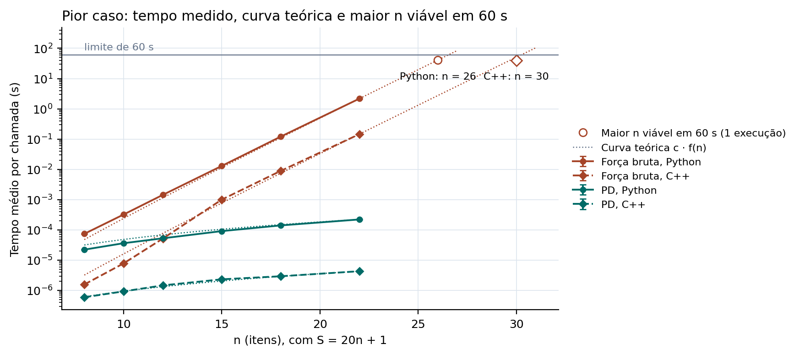
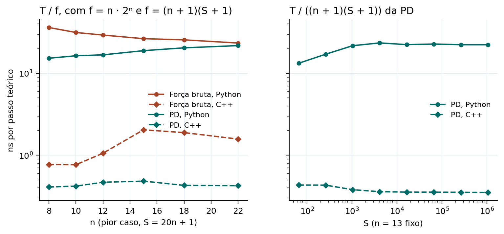
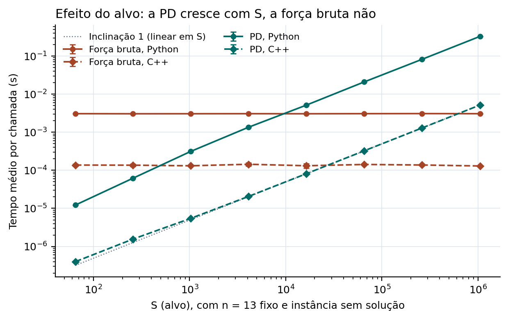
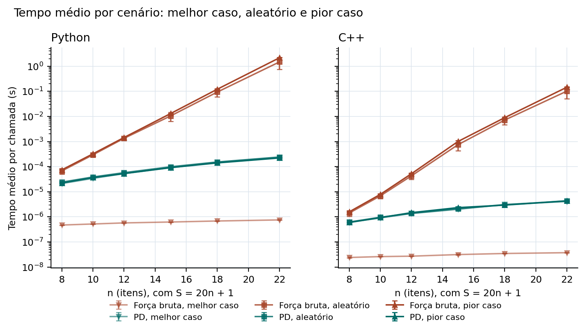

# 1. Descrição do problema e dos algoritmos

O problema sorteado para a Equipe 4 é o **Subconjunto Soma** (*Subset Sum*), em sua versão de decisão sobre inteiros não negativos (BEZERRA, 2026).

## Definição formal

**Entrada:** uma lista $V = (v_0, v_1, \dots, v_{n-1})$ de $n \ge 0$ inteiros não negativos ($v_i \in \mathbb{Z}_{\ge 0}$) e um alvo $S \in \mathbb{Z}_{\ge 0}$.

**Saída:** `SIM` se existir um subconjunto de índices $I \subseteq \{0, 1, \dots, n - 1\}$ tal que $\sum_{i \in I} v_i = S$, ou `NÃO` caso contrário.

Cada posição da lista pode ser usada no máximo uma vez; valores repetidos ocupam índices distintos e contam como elementos separados (por exemplo, $V = [5, 5]$ e $S = 10$ tem resposta `SIM` via $I = \{0, 1\}$). Como o subconjunto vazio ($I = \emptyset$) tem soma $0$, toda instância com $S = 0$ responde `SIM`, inclusive quando $n = 0$.

## Lógica geral e pseudocódigo

Ambos os algoritmos foram implementados em Python (CPython) e C++17 (`src/subset_sum.py` e `src/subset_sum.cpp`), com a mesma lógica e ordem de operações.

### Algoritmo A: Força bruta por máscaras binárias

Um vetor binário `mascara` de tamanho $n$ (bit menos significativo na posição $0$) representa o subconjunto atual e avança como um contador binário a partir de zero. A cada máscara, o algoritmo percorre as $n$ posições para somar os itens marcados e retorna `SIM` se atingir $S$. Para incrementar o contador, zera os bits iniciais iguais a $1$ até o primeiro $0$, trocando-o para $1$; quando todos os bits são $1$ ($i = n$), todas as $2^n$ máscaras foram testadas e retorna-se `NÃO`.

```text
algoritmo ForcaBruta(valores, alvo):
    n <- tamanho(valores)
    mascara <- vetor de n bytes inicializado com 0

    repita:
        soma <- 0
        para i de 0 ate n - 1:
            se mascara[i] == 1 entao:
                soma <- soma + valores[i]
        se soma == alvo entao:
            retorne SIM

        i <- 0
        enquanto i < n e mascara[i] == 1:
            mascara[i] <- 0
            i <- i + 1
        se i == n entao:
            retorne NAO
        mascara[i] <- 1
```

### Algoritmo B: Programação dinâmica unidimensional

A programação dinâmica (PD) mantém um vetor booleano `alcancavel` de tamanho $S + 1$, inicialmente `falso`, exceto `alcancavel[0] = verdadeiro`. Após processar os $i$ primeiros itens, `alcancavel[s]` indica se algum subconjunto deles soma $s$. Para cada `valor`, o laço interno percorre `soma` de $S$ até $0$ (mantendo $S + 1$ iterações fixas por item) e marca `alcancavel[soma] = verdadeiro` quando `soma >= valor` e `alcancavel[soma - valor]` é `verdadeiro`. Ao final, retorna `SIM` se `alcancavel[alvo]` for `verdadeiro`.

```text
algoritmo ProgramacaoDinamica(valores, alvo):
    alcancavel <- vetor booleano de tamanho alvo + 1, inicializado com falso
    alcancavel[0] <- verdadeiro

    para cada valor em valores:
        para soma de alvo ate 0 passo -1:
            se soma >= valor e alcancavel[soma - valor] entao:
                alcancavel[soma] <- verdadeiro

    se alcancavel[alvo] for verdadeiro entao:
        retorne SIM
    senao:
        retorne NAO
```

### Por que a atualização decrescente é obrigatória

Como `alcancavel` é atualizado no local (*in-place*), percorrer `soma` de $S$ até $0$ garante que `alcancavel[soma - valor]` (para `valor > 0`) ainda guarde o estado anterior ao item atual, impedindo sua reutilização. Com $V = [4]$ e $S = 8$ (resposta `NÃO`), a ordem decrescente testa $s = 8$ antes de $s = 4$: `alcancavel[4]` ainda é `falso`, logo `alcancavel[8]` permanece `falso` e apenas `alcancavel[4]` é marcado depois. Em ordem crescente, $s = 4$ marcaria `alcancavel[4]` e, na mesma passagem, $s = 8$ leria esse valor novo e marcaria `alcancavel[8] = verdadeiro`, reutilizando o item duas vezes ($4 + 4 = 8$).

## Exemplo resolvido à mão

Seja $V = [3, 5, 9, 12]$ ($n = 4$) e $S = 14$. A resposta é `SIM`, via $v_1 + v_2 = 5 + 9 = 14$.

Na força bruta, com `mascara[0..3]` associado a $[3, 5, 9, 12]$, o contador visita $7$ das $2^4 = 16$ máscaras até parar:

| Passo | Máscara `[m0, m1, m2, m3]` | Subconjunto | Soma | Ação |
| :---: | :---: | :---: | :---: | --- |
| 1 | `[0, 0, 0, 0]` | $\emptyset$ | 0 | $0 \neq 14$; incrementa |
| 2 | `[1, 0, 0, 0]` | $\{3\}$ | 3 | $3 \neq 14$; incrementa |
| 3 | `[0, 1, 0, 0]` | $\{5\}$ | 5 | $5 \neq 14$; incrementa |
| 4 | `[1, 1, 0, 0]` | $\{3, 5\}$ | 8 | $8 \neq 14$; incrementa |
| 5 | `[0, 0, 1, 0]` | $\{9\}$ | 9 | $9 \neq 14$; incrementa |
| 6 | `[1, 0, 1, 0]` | $\{3, 9\}$ | 12 | $12 \neq 14$; incrementa |
| 7 | `[0, 1, 1, 0]` | $\{5, 9\}$ | 14 | $14 = 14$; retorna `SIM` |

Na programação dinâmica, o vetor `alcancavel[0..14]` evolui item a item (somas acima de $14$ ficam fora do vetor):

| Etapa | Novas marcas (ordem decrescente) | Índices verdadeiros em `alcancavel` |
| --- | --- | --- |
| Inicial | $s = 0$ | $\{0\}$ |
| $v_0 = 3$ | $s = 3$ (de $0$) | $\{0, 3\}$ |
| $v_1 = 5$ | $s = 8$ (de $3$), $s = 5$ (de $0$) | $\{0, 3, 5, 8\}$ |
| $v_2 = 9$ | $s = 14$ (de $5$), $s = 12$ (de $3$), $s = 9$ (de $0$) | $\{0, 3, 5, 8, 9, 12, 14\}$ |
| $v_3 = 12$ | nenhuma nova ($s = 12$ já verdadeiro) | $\{0, 3, 5, 8, 9, 12, 14\}$ |

Ao final, `alcancavel[14]` é `verdadeiro` e o algoritmo retorna `SIM`; mesmo alcançando $14$ em $v_2 = 9$, a PD ainda processa $v_3 = 12$.

# 2. Classificação assintótica

Adota-se o modelo RAM de custo unitário, no qual valores, somas e índices cabem em uma palavra de máquina (operações aritméticas e acessos à memória em tempo $O(1)$). As expressões principais assumem $n \ge 1$ e $S \ge 1$; para $n = 0$, a força bruta custa $\Theta(1)$ e a PD custa $\Theta(S + 1)$.

## Algoritmo A: Força bruta

### Contagem de operações

Alocar e inicializar `mascara` custa $\Theta(n)$. Supondo que o algoritmo visite $m$ máscaras ($1 \le m \le 2^n$), o laço interno percorre todas as $n$ posições a cada máscara, executando $n$ testes, de $0$ a $n$ somas e uma comparação com `alvo`, o que custa $\Theta(n)$ por máscara e $\Theta(m \cdot n)$ no total.

Nos avanços do contador binário, ocorrem $k = m - 1$ incrementos quando há solução e $k = 2^n = m$ tentativas quando não há (a última zera a máscara e detecta $i = n$). Embora um único avanço custe $O(n)$ no pior passo, ao longo de $k$ incrementos a partir de zero o bit $j$ ($0 \le j < n$) é invertido exatamente $\lfloor k / 2^j \rfloor$ vezes:

$$\sum_{j=0}^{n-1} \left\lfloor \frac{k}{2^j} \right\rfloor \le \sum_{j=0}^{n-1} \frac{k}{2^j} \le 2k.$$

Logo, o custo total dos incrementos é $O(m)$, ou $O(1)$ amortizado por máscara (CORMEN et al., 2009, seção 17.1). Somando inicialização, varreduras e incrementos:

$$T(n, m) = \Theta(n) + \Theta(m \cdot n) + O(m) = \Theta(m \cdot n).$$

### Limites $O$, $\Omega$ e $\Theta$

Sobre todas as entradas de tamanho $n$, como $1 \le m \le 2^n$, a primeira varredura sempre ocorre e nenhuma execução supera $2^n$ máscaras; portanto $T(n) = O(n \cdot 2^n)$ e $T(n) = \Omega(n)$. Para um mesmo $n \ge 1$, uma instância com $S > 0$ e $v_0 = S$ visita $m = 2$ máscaras e custa $\Theta(n)$, enquanto uma instância sem solução visita $m = 2^n$ máscaras e custa $\Theta(n \cdot 2^n)$. Como $n = o(n \cdot 2^n)$, nenhuma função apenas de $n$ dá um limite $\Theta$ válido para toda instância: o limite justo por instância é $\Theta(m \cdot n)$, resultando em $T_{\text{pior}}(n) = \Theta(n \cdot 2^n)$ e $T_{\text{melhor}}(n) = \Theta(n)$.

### Espaço auxiliar

Além da entrada, o algoritmo aloca apenas `mascara` ($n$ bytes) e variáveis escalares constantes: espaço auxiliar $\Theta(n)$.

## Algoritmo B: Programação dinâmica

### Recorrência

Seja $A[i][s] \in \{\text{verdadeiro}, \text{falso}\}$ a existência de um subconjunto de $\{v_0, \dots, v_{i-1}\}$ com soma $s$ ($0 \le i \le n$, $0 \le s \le S$). Com caso base $A[0][0] = \text{verdadeiro}$ e $A[0][s] = \text{falso}$ para $1 \le s \le S$, vale:

$$A[i][s] = \begin{cases} A[i - 1][s], & \text{se } s < v_{i-1}, \\ A[i - 1][s] \lor A[i - 1][s - v_{i-1}], & \text{se } s \ge v_{i-1}. \end{cases}$$

A resposta é $A[n][S]$. Como a linha $i$ depende apenas da linha $i - 1$ em índices $\le s$, basta manter uma única linha `alcancavel[0..S]`, atualizada de $S$ até $0$.

### Contagem de operações e limites $O$, $\Omega$ e $\Theta$

Para qualquer entrada, inicializam-se $S + 1$ células ($\Theta(S + 1)$), o laço externo executa $n$ vezes e o interno executa $S + 1$ vezes sem parada antecipada, somando $n \cdot (S + 1)$ iterações de custo $\Theta(1)$ cada (uma comparação e, no máximo, uma leitura e uma escrita). O total é $(S + 1) + \Theta(n \cdot (S + 1)) = \Theta((n + 1)(S + 1))$. Para $n \ge 1$ e $S \ge 1$, têm-se simultaneamente $T(n, S) = O(n \cdot S)$ e $T(n, S) = \Omega(n \cdot S)$, logo $T(n, S) = \Theta(n \cdot S)$ em todos os casos.

### Espaço auxiliar e caráter pseudopolinomial

O vetor `alcancavel` reduz o espaço auxiliar de $\Theta(n \cdot S)$ da matriz completa para $\Theta(S + 1)$ (ou $\Theta(S)$ para $S \ge 1$). Na Seção 6, esses limites de espaço ($\Theta(n)$ na força bruta e $\Theta(S + 1)$ na PD) são confrontados com medições diretas de memória.

Embora $\Theta(n \cdot S)$ seja polinomial no valor numérico de $S$, a complexidade formal mede-se pelo comprimento da entrada em bits (GAREY; JOHNSON, 1979; MIT OPENCOURSEWARE, 2020a). Como $S \ge 1$ requer $b = \lfloor \log_2 S \rfloor + 1 = \Theta(\log S)$ bits e $S \ge 2^{b - 1}$, tempo e espaço da PD crescem exponencialmente em $b$, caracterizando um algoritmo **pseudopolinomial**.

| Algoritmo | $O$ (geral) | $\Omega$ (geral) | $\Theta$ (pior caso) | $\Theta$ (melhor caso) | Espaço auxiliar |
| --- | :---: | :---: | :---: | :---: | :---: |
| Força bruta | $O(n \cdot 2^n)$ | $\Omega(n)$ | $\Theta(n \cdot 2^n)$ | $\Theta(n)$ | $\Theta(n)$ |
| Programação dinâmica | $O(n \cdot S)$ | $\Omega(n \cdot S)$ | $\Theta(n \cdot S)$ | $\Theta(n \cdot S)$ | $\Theta(S)$ |

# 3. Melhor caso, pior caso e caso médio

## Algoritmo A: Força bruta

No melhor caso ($\Theta(n)$), o alvo é $S = 0$ (a primeira máscara, nula, já soma $0$) ou $v_0 = S > 0$ (a segunda máscara, `[1, 0, ..., 0]`, já soma $S$). Nos experimentos, usa-se $v_0 = S = 20n + 1$, evitando o caso degenerado $S = 0$ e mantendo $S$ na escala dos demais cenários.

No pior caso ($\Theta(n \cdot 2^n)$), a instância não tem solução ou tem como única solução a última máscara (toda igual a $1$), obrigando a visita às $2^n$ máscaras. Nos experimentos, todos os $n$ valores são pares e $S = 20n + 1$ é ímpar; como qualquer soma de pares é par, nenhuma combinação atinge $S$ e a busca é sempre exaustiva.

O caso médio depende da distribuição das entradas. Nas instâncias aleatórias do experimento, os $n$ valores $v_0, \dots, v_{n-1}$ são independentes e uniformes em $\{1, 2, \dots, 39\}$, com alvo $S = 20n + 1$. Como cada $v_i$ tem a mesma distribuição de $40 - v_i$, a soma total $W = \sum_{i=0}^{n-1} v_i$ é simétrica em torno de $20n$; logo $\Pr[W \le 20n] = \Pr[W \ge 20n]$ e $\Pr[W \le 20n] + \Pr[W \ge 20n] = 1 + \Pr[W = 20n] \ge 1$, donde:

$$\Pr[W < S] = \Pr[W \le 20n] \ge \frac{1}{2}.$$

Quando $W < S$, nenhum subconjunto alcança $S$, todas as $2^n$ máscaras são visitadas e cada visita custa ao menos $c_1 \cdot n$ operações para uma constante $c_1 > 0$. Portanto:

$$\mathbb{E}[T(n)] \ge \Pr[W < S] \cdot c_1 \cdot n \cdot 2^n \ge \frac{1}{2} \cdot c_1 \cdot n \cdot 2^n = \Omega(n \cdot 2^n).$$

Com o limite superior $O(n \cdot 2^n)$, o tempo esperado é $\Theta(n \cdot 2^n)$. Quando $W \ge S$ e existe solução, a busca encerra na primeira máscara válida na ordem do contador binário, gerando grande dispersão entre instâncias com e sem solução.

## Algoritmo B: Programação dinâmica

Na PD implementada, melhor, pior e caso médio coincidem em $\Theta(n \cdot S)$, pois ambos os laços dependem apenas de $n$ e $S$, nunca dos valores de $V$ nem da existência de solução. Os valores afetam apenas quantas vezes a guarda `soma >= valor` é satisfeita e quantas posições passam a `verdadeiro`, alterando o custo por iteração sem mudar a ordem assintótica. Nos experimentos, os cenários são definidos segundo a força bruta, mas as quatro implementações rodam sempre sobre as mesmas entradas.

# 4. Aplicabilidade prática

Como o pior caso da força bruta ($\Theta(n \cdot 2^n)$) e a PD ($\Theta(n \cdot S)$) compartilham o fator $n$, a fronteira assintótica no pior caso compara $2^n$ com $S$ (ou $n$ com $\log_2 S$): se $2^n \ll S$, a força bruta vence em tempo e memória; se $S \ll 2^n$, a PD é ordens de grandeza mais rápida. Mesmo com $S \ll 2^n$, a força bruta ainda pode terminar antes se houver solução entre as primeiras máscaras.

A força bruta é indicada quando $n$ é pequeno e $S$ é muito grande, ou quando a memória é restrita. Em uma auditoria financeira com $n = 20$ pagamentos em centavos e alvo $S = 10^{10}$ (R\$ 100 milhões), a força bruta visita no máximo $2^{20} \approx 10^6$ máscaras usando $20$ bytes auxiliares, enquanto a PD exigiria cerca de $10$ GB de RAM e $2 \times 10^{11}$ iterações. Por usar espaço $\Theta(n)$ independente de $S$ e ter lógica simples, a força bruta também funciona como oráculo confiável para validar implementações mais complexas em instâncias pequenas.

A programação dinâmica é preferível quando $n$ é moderado ou grande e $S$ permanece moderado. No pior caso, $2^n$ esgota rapidamente o tempo disponível (em nossos testes, a força bruta concluiu até $n = 26$ em Python e $n = 30$ em C++ em menos de $60\text{ s}$, sendo interrompida em $n = 27$ e $n = 31$), enquanto a PD resolve centenas de itens com $S$ na casa de milhares ou poucos milhões. É o caso ao reconciliar $n = 200$ valores pequenos para somar $S = 5.000$ ($10^6$ iterações contra $2^{200}$ máscaras) ou verificar se $n = 100$ durações em segundos preenchem uma janela de $S = 3.600$ segundos ($3{,}6 \times 10^5$ iterações e $3{,}6$ KB de RAM). Além disso, seu custo $\Theta(n \cdot S)$ é previsível, independentemente de haver solução.

Para alvos muito grandes, o espaço $\Theta(S)$ limita a PD antes mesmo do tempo: $S = 10^9$ ocupa $1$ GB com 1 byte por célula, e mesmo com *bitset* de 1 bit por soma alvos $S \ge 10^{12}$ excedem a RAM de máquinas comuns. Quando tanto $n$ quanto $S$ são grandes (como $n = 40$ e $S = 10^{15}$), uma alternativa conhecida, não implementada neste trabalho, é o método **meet-in-the-middle** (HOROWITZ; SAHNI, 1974), que divide a entrada em duas metades, gera as somas de cada lado e busca pares que somem $S$. Ele decide o problema em tempo e espaço $O(2^{n/2})$, sem depender de $S$.

# 5. Simulação e metodologia experimental

## Entradas, tamanhos e cenários

No experimento principal, avaliaram-se seis tamanhos em progressão geométrica aproximada, $n \in \{8, 10, 12, 15, 18, 22\}$, com alvo $S = 20n + 1$ ($161$ a $441$); os tamanhos são pequenos devido ao custo exponencial da força bruta (BEZERRA, 2026). Para cada $n$, testaram-se três cenários: melhor caso, com $v_0 = S$ e demais valores uniformes em $\{1, \dots, 39\}$; pior caso, com $n$ valores pares em $2 \cdot U\{11, \dots, 20\}$ e alvo ímpar, garantindo ausência de solução; e caso aleatório, com $15$ instâncias de valores uniformes em $\{1, \dots, 39\}$.

Para isolar o efeito de $S$, um segundo experimento (`scripts/variar_alvo.py`) fixa $n = 13$ em uma instância de pior caso e varia $S = 4^k + 1$ para $k = 3, \dots, 10$ ($65$ a $1.048.577$), todas sem solução. Todas as entradas são geradas por `scripts/gerar_entradas.py` com semente fixa `20261123` (e sementes derivadas para as famílias auxiliares) e salvas em `dados/*.tsv`.

## Mesmas entradas e repetições

As quatro implementações (dois algoritmos em Python e C++) leem exatamente os mesmos arquivos TSV via `src/executar.py` e `src/subset_sum.cpp`. Cada grupo reúne $15$ amostras, resumidas por média e desvio-padrão amostral: nos cenários de melhor caso, pior caso, variação de alvo e memória, a mesma instância é medida $15$ vezes; no cenário aleatório, medem-se $15$ instâncias distintas uma vez cada.

## O que é medido e aquecimento

Cronometram-se apenas as chamadas ao algoritmo (incluindo a alocação de `mascara` ou `alcancavel`) e o laço de medição; leitura, conversão e escrita ficam fora. Usam-se `time.perf_counter_ns` em Python e `std::chrono::steady_clock` em C++. Antes de medir cada algoritmo, executa-se um aquecimento de $500\text{ ms}$. Em seguida, dobra-se o número de chamadas por lote até atingir pelo menos $1\text{ ms}$; o lote de calibração é descartado e coletam-se $15$ amostras com esse tamanho de lote, dividindo o tempo total pelo número de chamadas. Quando uma única chamada já dura ao menos $1\text{ s}$, ela serve diretamente como primeira amostra.

## Ambiente de execução

A Tabela 1 resume o ambiente utilizado nas medições.

| Componente | Especificação |
| --- | --- |
| CPU | Apple M4 (10 processadores lógicos) |
| Memória RAM | 16 GiB (17.179.869.184 bytes) |
| Sistema operacional | macOS 26.6.2 (arm64, 64 bits) |
| Interpretador Python | CPython 3.11.9 (sem flags especiais) |
| Compilador C++ | Apple clang 21.0.0 |
| Flags de compilação C++ | `-std=c++17 -O2 -DNDEBUG -Wall -Wextra -pedantic` |
| Relógios | `time.perf_counter_ns` (Python) e `std::chrono::steady_clock` (C++) |

: Ambiente de execução registrado em `resultados/ambiente.json`.

## Corretude, teórico × medido e maior $n$ em 60 s

A suíte `tests/testar.py` valida as quatro implementações em $172$ entradas ($12$ casos de borda e $160$ aleatórias), comparando as $688$ decisões com um oráculo independente e verificando a rejeição de entradas negativas. Nos experimentos em lote, cada resposta gravada também é conferida contra um segundo oráculo independente por *bitset* ($1.080$ leituras no experimento principal, $480$ na variação de alvo e $900$ em memória).

O confronto teórico × medido usa a razão $T / f$, com $f = n \cdot 2^n$ na força bruta e $f = (n + 1)(S + 1)$ na PD, além das curvas $c \cdot f(n)$. Para o limite de $60\text{ s}$, `scripts/limite.py` executa a família de pior caso uma vez por $n$, interrompendo execuções acima de $61{,}5\text{ s}$ e confirmando resposta `NÃO` em todas as concluídas.

## Memória (bônus)

A memória auxiliar é medida em passagem separada (`scripts/medir_memoria.py`) para não afetar os tempos. Em Python, `tracemalloc` registra o pico de alocação rastreada durante cada chamada; em C++, um alocador contador em `mascara` e `alcancavel` registra o pico de bytes solicitados pelos vetores auxiliares. Realizam-se duas varreduras com $15$ amostras por ponto: $n$ de $16$ a $65.536$ (potências de $4$) com $S = 100$ e $v_0 = S$, e $S$ de $65$ a $1.048.577$ com $n = 13$ fixo.

# 6. Gráficos e tabelas de comparação

## Teórico × medido

A Figura 1 e a Tabela 2 apresentam os tempos no pior caso ($S = 20n + 1$); a Figura 2 e a Tabela 3 mostram a razão $T / f$ para $f(n) = n \cdot 2^n$ na força bruta e $f(n, S) = (n + 1)(S + 1)$ na PD, e a Tabela 4 detalha o custo por máscara $T / 2^n$.

{width=92%}

| n | S | Força bruta, Python | Força bruta, C++ | PD, Python | PD, C++ |
|---:|---:|---:|---:|---:|---:|
| 8 | 161 | 74,3 ± 1,48 µs | 1,58 ± 0,04 µs | 22,3 ± 0,33 µs | 597 ± 6,00 ns |
| 10 | 201 | 323 ± 3,34 µs | 7,84 ± 0,08 µs | 36,4 ± 0,58 µs | 933 ± 8,33 ns |
| 12 | 241 | 1,44 ± 0,02 ms | 52,0 ± 4,72 µs | 52,9 ± 0,79 µs | 1,47 ± 0,03 µs |
| 15 | 301 | 13,0 ± 0,09 ms | 1,00 ± 0,07 ms | 91,4 ± 1,28 µs | 2,33 ± 0,02 µs |
| 18 | 361 | 121 ± 2,93 ms | 8,91 ± 0,14 ms | 141 ± 1,08 µs | 2,95 ± 0,05 µs |
| 22 | 441 | 2,16 ± 0,00 s | 145 ± 0,72 ms | 222 ± 6,18 µs | 4,32 ± 0,04 µs |

: Tempo por chamada no cenário de pior caso (média ± desvio padrão amostral, 15 amostras).

{width=92%}

| n | S | Força bruta, Python | Força bruta, C++ | PD, Python | PD, C++ |
|---:|---:|---:|---:|---:|---:|
| 8 | 161 | 36,3 | 0,77 | 15,3 | 0,41 |
| 10 | 201 | 31,5 | 0,77 | 16,4 | 0,42 |
| 12 | 241 | 29,3 | 1,06 | 16,8 | 0,47 |
| 15 | 301 | 26,5 | 2,04 | 18,9 | 0,48 |
| 18 | 361 | 25,6 | 1,89 | 20,5 | 0,43 |
| 22 | 441 | 23,4 | 1,57 | 21,8 | 0,42 |

: Razão $T / f$ no pior caso, em ns por passo teórico ($f = n \cdot 2^n$ na força bruta e $f = (n + 1)(S + 1)$ na PD).

| n | Python | C++ |
|---:|---:|---:|
| 8 | 290 | 6,16 |
| 10 | 315 | 7,66 |
| 12 | 352 | 12,7 |
| 15 | 398 | 30,6 |
| 18 | 461 | 34,0 |
| 22 | 516 | 34,6 |
| 26 | 606 |  |
| 30 |  | 36,9 |

: Custo por máscara no pior caso da força bruta, $T / 2^n$ em ns (as duas últimas linhas vêm da busca do limite de 60 s, com uma execução).

Na PD em C++, a razão $T / ((n + 1)(S + 1))$ mantém-se entre $0{,}41$ e $0{,}48\text{ ns}$ por passo na Tabela 3 e estabiliza em $0{,}35\text{ ns}$ a partir de $S = 16.385$ na Tabela 6, confirmando $\Theta(n \cdot S)$.

Na PD em Python, a razão sobe de $15{,}3$ para $21{,}8\text{ ns}$ na Tabela 3 e de $13{,}3\text{ ns}$ ($S = 65$) até um patamar entre $22{,}4$ e $23{,}5\text{ ns}$ a partir de $S = 4.097$ na Tabela 6. Atribuímos essa subida inicial ao curto-circuito da guarda `soma >= valor and alcancavel[soma - valor]`: para cada item $v \le S$, exatamente $v$ das $S + 1$ iterações pulam a leitura do vetor, fração que encolhe conforme $S$ cresce.

Na força bruta em Python, $T / (n \cdot 2^n)$ decresce de $36{,}3$ para $23{,}4\text{ ns}$ na Tabela 3, enquanto o custo por máscara na Tabela 4 sobe linearmente de $290$ ($n = 8$) para $516\text{ ns}$ ($n = 22$). O ajuste linear $T / 2^n \approx 153 + 16{,}6\,n\text{ ns}$ nessa faixa (prevendo $585\text{ ns}$ frente aos $606\text{ ns}$ medidos em $n = 26$) reflete um custo fixo $a$ por máscara somado ao custo $b \cdot n$ da varredura, fazendo $T / (n \cdot 2^n) = b + a / n$ convergir para $b$.

Na força bruta em C++, o custo por máscara na Tabela 4 salta de $12{,}7\text{ ns}$ ($n = 12$) para $30{,}6\text{ ns}$ ($n = 15$) e depois permanece entre $30{,}6$ e $36{,}9\text{ ns}$ até $n = 30$, enquanto $T / (n \cdot 2^n)$ cai de $2{,}04$ para $1{,}57\text{ ns}$ entre $n = 15$ e $n = 22$ na Tabela 3. Atribuímos o salto entre $n = 12$ e $n = 15$ ao preditor de desvios do processador, que consegue memorizar sequências curtas de máscaras nos lotes pequenos e satura quando $2^n$ cresce.

Em conjunto, as medições das Figuras 1 e 2 confirmam as ordens $\Theta(n \cdot 2^n)$ e $\Theta(n \cdot S)$.

## Algoritmo × algoritmo

No pior caso com $S = 20n + 1$ (Figura 1, Tabela 2 e Tabela 5), a força bruta já parte $3{,}33$ vezes mais lenta que a PD em Python e $2{,}64$ vezes em C++ em $n = 8$. A razão cresce exponencialmente e atinge $9.756$ vezes em Python ($2{,}16\text{ s}$ contra $222\text{ }\mu\text{s}$) e $33.662$ vezes em C++ ($145\text{ ms}$ contra $4{,}32\text{ }\mu\text{s}$) em $n = 22$.

| n | Força bruta: Python / C++ | PD: Python / C++ | Python: força bruta / PD | C++: força bruta / PD |
|---:|---:|---:|---:|---:|
| 8 | 47,1 | 37,4 | 3,33 | 2,64 |
| 10 | 41,2 | 39,0 | 8,87 | 8,41 |
| 12 | 27,7 | 36,0 | 27,3 | 35,3 |
| 15 | 13,0 | 39,2 | 143 | 430 |
| 18 | 13,6 | 47,8 | 858 | 3.026 |
| 22 | 14,9 | 51,3 | 9.756 | 33.662 |

: Comparações no pior caso: quantas vezes um tempo médio é maior que o outro.

Quando o alvo $S$ cresce de forma independente de $n$, a vantagem se inverte, como mostram a Figura 3 e a Tabela 6 para $n = 13$ fixo ($2^{13} = 8.192$).

{width=92%}

| S | Força bruta, Python | Força bruta, C++ | PD, Python | PD, C++ | PD Python: ns por passo | PD C++: ns por passo |
|---:|---:|---:|---:|---:|---:|---:|
| 65 | 3,07 ± 0,03 ms | 137 ± 9,23 µs | 12,3 ± 0,15 µs | 400 ± 6,19 ns | 13,3 | 0,43 |
| 257 | 3,05 ± 0,03 ms | 136 ± 9,50 µs | 61,8 ± 0,85 µs | 1,56 ± 0,04 µs | 17,1 | 0,43 |
| 1.025 | 3,05 ± 0,04 ms | 131 ± 0,73 µs | 312 ± 7,44 µs | 5,45 ± 0,04 µs | 21,7 | 0,38 |
| 4.097 | 3,06 ± 0,04 ms | 144 ± 15,4 µs | 1,35 ± 0,04 ms | 20,6 ± 0,10 µs | 23,5 | 0,36 |
| 16.385 | 3,05 ± 0,03 ms | 132 ± 18,0 µs | 5,14 ± 0,07 ms | 81,4 ± 1,10 µs | 22,4 | 0,35 |
| 65.537 | 3,07 ± 0,03 ms | 142 ± 1,65 µs | 20,9 ± 0,39 ms | 325 ± 5,85 µs | 22,8 | 0,35 |
| 262.145 | 3,08 ± 0,03 ms | 138 ± 4,07 µs | 82,1 ± 0,60 ms | 1,29 ± 0,01 ms | 22,4 | 0,35 |
| 1.048.577 | 3,06 ± 0,03 ms | 130 ± 3,45 µs | 328 ± 1,81 ms | 5,15 ± 0,02 ms | 22,4 | 0,35 |

: Efeito do alvo com n = 13 fixo e instância sem solução (média ± desvio padrão amostral, 15 amostras).

Na Figura 3 e na Tabela 6, a força bruta mantém-se estável entre $3{,}05$ e $3{,}08\text{ ms}$ em Python e entre $130$ e $144\text{ }\mu\text{s}$ em C++, enquanto a PD cresce linearmente com $S$, quadruplicando o tempo a cada passo nos alvos maiores. A inversão ocorre entre $S = 4.097$ e $S = 16.385$ em Python e entre $S = 16.385$ e $S = 65.537$ em C++, acompanhando a fronteira $2^{13} = 8.192$ deslocada pelas constantes de cada linguagem. Em $S = 1.048.577$, a força bruta é cerca de $107$ vezes mais rápida em Python ($3{,}06\text{ ms}$ contra $328\text{ ms}$) e cerca de $40$ vezes em C++ ($130\text{ }\mu\text{s}$ contra $5{,}15\text{ ms}$).

## Linguagem × linguagem

Na Tabela 5, C++ supera Python por um fator de $36{,}0$ a $51{,}3$ na PD, crescendo conforme a razão por passo em Python sobe na Tabela 3. Na força bruta, a vantagem de C++ cai de $47{,}1$ vezes em $n = 8$ para a faixa de $13{,}0$ a $14{,}9$ vezes a partir de $n = 15$, acompanhando o salto do custo por máscara em C++ na Tabela 4. Mesmo com esse ganho da compilação, a escolha do algoritmo domina: na Tabela 2, a PD em Python já supera a força bruta em C++ por cerca de $11$ vezes em $n = 15$ ($91{,}4\text{ }\mu\text{s}$ contra $1{,}00\text{ ms}$) e por cerca de $656$ vezes em $n = 22$ ($222\text{ }\mu\text{s}$ contra $145\text{ ms}$).

## Melhor caso, pior caso e caso aleatório

A Figura 4 e as Tabelas 7, 8 e 9 comparam os três cenários nas duas linguagens.

{width=92%}

| n | S | Força bruta, Python | Força bruta, C++ | PD, Python | PD, C++ |
|---:|---:|---:|---:|---:|---:|
| 8 | 161 | 473 ± 6,84 ns | 24,1 ± 1,01 ns | 21,2 ± 0,15 µs | 611 ± 8,61 ns |
| 10 | 201 | 520 ± 8,70 ns | 26,2 ± 0,32 ns | 34,0 ± 0,29 µs | 905 ± 13,9 ns |
| 12 | 241 | 575 ± 6,65 ns | 27,2 ± 0,39 ns | 52,8 ± 0,19 µs | 1,37 ± 0,02 µs |
| 15 | 301 | 624 ± 11,2 ns | 31,5 ± 1,19 ns | 91,2 ± 0,77 µs | 2,00 ± 0,02 µs |
| 18 | 361 | 685 ± 12,8 ns | 34,8 ± 0,53 ns | 147 ± 1,00 µs | 3,13 ± 0,03 µs |
| 22 | 441 | 756 ± 8,88 ns | 37,5 ± 0,77 ns | 229 ± 1,26 µs | 4,08 ± 0,13 µs |

: Tempo por chamada no cenário de melhor caso (média ± desvio padrão amostral, 15 amostras).

| n | S | Força bruta, Python | Força bruta, C++ | PD, Python | PD, C++ |
|---:|---:|---:|---:|---:|---:|
| 8 | 161 | 67,5 ± 17,0 µs | 1,42 ± 0,36 µs | 24,1 ± 0,45 µs | 622 ± 26,1 ns |
| 10 | 201 | 295 ± 60,0 µs | 6,82 ± 1,48 µs | 38,7 ± 0,65 µs | 968 ± 41,4 ns |
| 12 | 241 | 1,34 ± 0,20 ms | 42,8 ± 11,5 µs | 57,4 ± 1,03 µs | 1,38 ± 0,04 µs |
| 15 | 301 | 10,5 ± 4,14 ms | 749 ± 326 µs | 98,7 ± 1,72 µs | 2,12 ± 0,06 µs |
| 18 | 361 | 93,3 ± 33,5 ms | 7,14 ± 2,55 ms | 153 ± 1,54 µs | 3,00 ± 0,08 µs |
| 22 | 441 | 1,48 ± 0,74 s | 101 ± 50,8 ms | 241 ± 4,29 µs | 4,36 ± 0,15 µs |

: Tempo por chamada no cenário aleatório (média ± desvio padrão amostral, 15 amostras).

| n | Instâncias | Soma total < S | Sem solução |
|---:|---:|---:|---:|
| 8 | 15 | 8 | 13 |
| 10 | 15 | 7 | 11 |
| 12 | 15 | 10 | 12 |
| 15 | 15 | 8 | 9 |
| 18 | 15 | 8 | 9 |
| 22 | 15 | 6 | 7 |

: Instâncias do cenário aleatório por tamanho: quantas têm soma total abaixo do alvo e quantas não têm solução.

Na Figura 4 e na Tabela 7, a força bruta cresce linearmente no melhor caso ($\Theta(n)$), ficando entre $473$ e $756\text{ ns}$ em Python e entre $24{,}1$ e $37{,}5\text{ ns}$ em C++. No cenário aleatório (Tabela 8), seu tempo acompanha a curva exponencial do pior caso com desvio-padrão alto, como $1{,}48 \pm 0{,}74\text{ s}$ em Python e $101 \pm 50{,}8\text{ ms}$ em C++ em $n = 22$. A Tabela 9 explica essa dispersão: das $15$ instâncias por tamanho, entre $7$ ($n = 22$) e $13$ ($n = 8$) não têm solução e percorrem todas as $2^n$ máscaras, enquanto as demais encerram ao encontrar a primeira combinação válida. Já a PD mantém médias próximas nos três cenários ($222$ a $241\text{ }\mu\text{s}$ em Python e $4{,}08$ a $4{,}36\text{ }\mu\text{s}$ em C++ em $n = 22$).

## Maior $n$ viável em 60 s

| Linguagem | Maior n viável | Tempo medido | Primeiro n fora do limite |
|---:|---:|---:|---:|
| Python | 26 | 40,6 s | 27 |
| C++ | 30 | 39,6 s | 31 |

: Maior n da força bruta que termina em até 60 s no pior caso (uma execução por n).

Na Figura 1 e na Tabela 10, a força bruta concluiu até $n = 26$ em Python ($40{,}6\text{ s}$) e $n = 30$ em C++ ($39{,}6\text{ s}$), com $n = 27$ e $n = 31$ interrompidos no prazo de $61{,}5\text{ s}$. Como avançar de $n$ para $n + 1$ mais que dobra o número de passos ($2(n + 1)/n$), a vantagem de C++ traduz-se em apenas quatro itens adicionais no orçamento de $60\text{ s}$.

## Memória medida × espaço teórico (bônus)

A Figura 5 e as Tabelas 11 e 12 confrontam o pico de memória auxiliar medido com os limites $\Theta(n)$ e $\Theta(S + 1)$ da Seção 2.

{width=92%}

| n | Teórico força bruta (n) | Teórico PD (S + 1) | Força bruta, Python | Força bruta, C++ | PD, Python | PD, C++ |
|---:|---:|---:|---:|---:|---:|---:|
| 16 | 16 | 101 | 233 | 16 | 302 | 101 |
| 64 | 64 | 101 | 281 | 64 | 302 | 101 |
| 256 | 256 | 101 | 473 | 256 | 302 | 101 |
| 1.024 | 1.024 | 101 | 1.269 | 1.024 | 302 | 101 |
| 4.096 | 4.096 | 101 | 4.341 | 4.096 | 302 | 101 |
| 16.384 | 16.384 | 101 | 16.629 | 16.384 | 302 | 101 |
| 65.536 | 65.536 | 101 | 65.781 | 65.536 | 302 | 101 |

: Pico de memória auxiliar em bytes ao variar n, com S = 100 fixo (valores idênticos nas 15 repetições).

| S | Teórico força bruta (n) | Teórico PD (S + 1) | Força bruta, Python | Força bruta, C++ | PD, Python | PD, C++ |
|---:|---:|---:|---:|---:|---:|---:|
| 65 | 13 | 66 | 294 | 13 | 267 | 66 |
| 257 | 13 | 258 | 294 | 13 | 491 | 258 |
| 1.025 | 13 | 1.026 | 294 | 13 | 1.259 | 1.026 |
| 4.097 | 13 | 4.098 | 294 | 13 | 4.331 | 4.098 |
| 16.385 | 13 | 16.386 | 294 | 13 | 16.619 | 16.386 |
| 65.537 | 13 | 65.538 | 294 | 13 | 65.771 | 65.538 |
| 262.145 | 13 | 262.146 | 294 | 13 | 262.379 | 262.146 |
| 1.048.577 | 13 | 1.048.578 | 294 | 13 | 1.048.811 | 1.048.578 |

: Pico de memória auxiliar em bytes ao variar S, com n = 13 fixo (valores idênticos nas 15 repetições).

As leituras foram idênticas nas $15$ repetições. Em C++, os picos registrados pelo alocador coincidem exatamente com $n$ bytes na força bruta ($16$ a $65.536$ bytes na Tabela 11; $13$ bytes na Tabela 12) e $S + 1$ bytes na PD ($101$ bytes na Tabela 11; $66$ a $1.048.578$ bytes na Tabela 12). Em Python, o `tracemalloc` acompanha o mesmo crescimento linear com uma sobrecarga quase constante de $201$ a $281$ bytes de objetos do interpretador. Por isso, na Figura 5 as curvas de Python partem perto de $300$ bytes e convergem para as retas teóricas quando o vetor principal domina (como $1.048.811$ contra $1.048.578$ bytes em $S = 1.048.577$). Assim, a memória da força bruta depende apenas de $n$ e a da PD apenas de $S$, confirmando o compromisso central entre tempo exponencial em $n$ e espaço proporcional a $S$.

# 7. Reflexão sobre P e NP

## Pertencimento a P e NP

O Subconjunto Soma é um problema de decisão e pertence à classe **NP**, mas não se sabe se pertence a **P**: por ser **NP-completo** (KARP, 1972; GAREY; JOHNSON, 1979), está em P se, e somente se, $\text{P} = \text{NP}$.

Para uma instância positiva $(V, S)$, o certificado é um vetor de $n$ bits indicando os índices escolhidos. O verificador percorre as $n$ posições, soma os valores marcados e compara o resultado com $S$. Se valores e alvo ocupam até $b$ bits, as somas parciais cabem em $O(b + \log(n + 1))$ bits e a verificação custa $O(n \cdot (b + \log(n + 1)))$, polinomial no comprimento da entrada (CORMEN et al., 2009, seção 34.2); logo, o problema está em NP.

A existência da PD em $\Theta(n \cdot S)$ não contradiz a NP-completude porque o tempo é polinomial no valor numérico de $S$, não em seu número de bits ($\Theta(\log S)$). Problemas NP-completos que admitem algoritmo pseudopolinomial são ditos **fracamente NP-completos** (GAREY; JOHNSON, 1979; MIT OPENCOURSEWARE, 2020b).

## Problemas vizinhos e o que separa o tratável do difícil

Dois problemas NP-completos são vizinhos diretos do Subconjunto Soma (BEZERRA, 2026). Na **Partição** (*Partition*), dada uma lista $A = (a_0, \dots, a_{n-1})$ de inteiros não negativos, decide-se se os índices podem ser divididos em duas partes disjuntas de mesma soma ($\sum_{i \in I} a_i = \sum_{j \notin I} a_j$; KARP, 1972). Na **Mochila 0/1** (*0/1 Knapsack*, decisão), dados $n$ itens com pesos $w_i$ e valores $p_i$ inteiros não negativos, capacidade $C$ e limiar $K$, decide-se se existe $I$ com $\sum_{i \in I} w_i \le C$ e $\sum_{i \in I} p_i \ge K$; o Subconjunto Soma é o caso particular $p_i = w_i = v_i$ e $C = K = S$.

O que separa o tratável do difícil é a escala numérica e a restrição de integralidade. Quando $S$ é limitado por um polinômio em $n$ (ou dado em unário), a PD em $\Theta(n \cdot S)$ é polinomial; com inteiros arbitrários em binário, $S$ pode ser exponencial no tamanho da entrada. O mesmo ocorre na Partição (PD com alvo $W / 2$ quando a soma total $W$ é par, e resposta `NÃO` quando é ímpar) e na Mochila 0/1 (PD pseudopolinomial em $C$). Já na **Mochila Fracionária**, relaxar a integralidade permite tomar frações contínuas de cada item: o algoritmo guloso por razão valor/peso resolve a otimização em $O(n \log n)$ e coloca a versão de decisão em P, bastando comparar o ótimo com $K$ (CORMEN et al., 2009, seção 16.2).

## Redução polinomial: Subconjunto Soma para Partição

Seguindo Karp (1972), dada uma instância $(V, S)$ de Subconjunto Soma com soma total $W = \sum_{i=0}^{n-1} v_i$: se $S > W$, nenhum subconjunto alcança $S$, então mapeia-se diretamente para uma instância negativa fixa de Partição, como $[1]$. Para $0 \le S \le W$, anexam-se dois inteiros positivos nos índices $n$ e $n + 1$:

$$A' = (v_0, \dots, v_{n-1},\; S + 1,\; W + 1 - S).$$

A soma total de $A'$ é $W' = 2W + 2$, logo cada parte de uma partição deve somar $W + 1$. Se existe $I \subseteq \{0, \dots, n - 1\}$ com $\sum_{i \in I} v_i = S$, então $I \cup \{n + 1\}$ soma $S + (W + 1 - S) = W + 1$, e o complementar $(\{0, \dots, n - 1\} \setminus I) \cup \{n\}$ soma $(W - S) + (S + 1) = W + 1$. Reciprocamente, se $A'$ admite partição em duas partes de soma $W + 1$, os índices $n$ e $n + 1$ não podem ficar juntos porque $(S + 1) + (W + 1 - S) = W + 2 > W + 1$ e todos os valores são não negativos; portanto, os índices originais no mesmo lado de $n + 1$ somam $(W + 1) - (W + 1 - S) = S$. A redução executa em tempo linear no número de bits da entrada.

Como exemplo, para $V = [2, 3, 4, 5]$ ($W = 14$) e $S = 9$, obtém-se $A' = [2, 3, 4, 5, 10, 6]$ com soma total $30$ e metade-alvo $15$. Como $10 + 6 = 16 > 15$, os índices $4$ e $5$ ficam em lados opostos: $\{2, 3, 5\}$ (valores $4, 5, 6$) e $\{0, 1, 4\}$ (valores $2, 3, 10$) somam $15$, recuperando $I = \{2, 3\}$ com soma $4 + 5 = 9$. Para $S = 20 > 14$, o caso de borda devolve uma instância negativa imediatamente.

## Algoritmo aproximado

Na versão de otimização (maximizar a soma alcançada sem exceder $S$), o algoritmo `APPROX-SUBSET-SUM` (CORMEN et al., 2009, seção 35.5) é um **FPTAS** (*Fully Polynomial-Time Approximation Scheme*): ele mantém listas ordenadas de somas alcançáveis e aplica uma poda (*trimming*) que descarta valores próximos dentro de um fator relativo ligado a $\varepsilon / (2n)$. Para qualquer $\varepsilon \in (0, 1)$, retorna em tempo polinomial em $n$, $1/\varepsilon$ e no número de bits da entrada uma soma viável de pelo menos $(1 - \varepsilon)$ vezes o ótimo (recuperar os índices exige guardar o predecessor de cada soma mantida). Essa família de esquemas deriva do primeiro FPTAS para Mochila 0/1 e Subconjunto Soma, proposto por Ibarra e Kim (1975).

# 8. Contribuições

A divisão de tarefas da Equipe 4 foi a seguinte, com todos os quatro integrantes preparando a apresentação oral:

| Integrante | Contribuições |
| --- | --- |
| Israel Erlich | Definição do problema, força bruta em Python e C++ e entradas de melhor e pior caso. |
| Luís Augusto | Programação dinâmica em Python e C++, recorrência e análise de tempo e espaço. |
| Theo Moura | Geração de entradas, scripts de medição de tempo e de memória, tabelas, gráficos e interpretação dos resultados. |
| Guilherme Rabelo | Discussão sobre P e NP, redução para Partição, montagem do relatório, repositório e entrega. |

# 9. Declaração de uso de IA

Conforme as regras do projeto, declara-se que as ferramentas de inteligência artificial Claude, GPT e Gemini foram usadas como apoio para escrever e revisar o código, gerar os gráficos, redigir e revisar o texto e organizar o pdf

# Referências

BEZERRA, Daniel. *Teoria da Computação: Projeto de Complexidade*. Enunciado, 2026.

CORMEN, Thomas H.; LEISERSON, Charles E.; RIVEST, Ronald L.; STEIN, Clifford. *Introduction to Algorithms*. 3. ed. Cambridge, MA: MIT Press, 2009.

GAREY, Michael R.; JOHNSON, David S. *Computers and Intractability: A Guide to the Theory of NP-Completeness*. San Francisco: W. H. Freeman, 1979.

HOROWITZ, Ellis; SAHNI, Sartaj. Computing Partitions with Applications to the Knapsack Problem. *Journal of the ACM*, v. 21, n. 2, p. 277-292, abr. 1974.

IBARRA, Oscar H.; KIM, Chul E. Fast Approximation Algorithms for the Knapsack and Sum of Subset Problems. *Journal of the ACM*, v. 22, n. 4, p. 463-468, out. 1975.

KARP, Richard M. Reducibility Among Combinatorial Problems. In: MILLER, Raymond E.; THATCHER, James W. (ed.). *Complexity of Computer Computations*. New York: Plenum Press, 1972. p. 85-103. Disponível em: <https://doi.org/10.1007/978-1-4684-2001-2_9>.

MIT OPENCOURSEWARE. *6.006 Introduction to Algorithms. Lecture 18: Pseudopolynomial*. 2020a. Disponível em: <https://ocw.mit.edu/courses/6-006-introduction-to-algorithms-spring-2020/f62798df9d8020e1c92130bd76a26f20_MIT6_006S20_lec18.pdf>.

MIT OPENCOURSEWARE. *6.006 Introduction to Algorithms. Lecture 19: Complexity*. 2020b. Disponível em: <https://ocw.mit.edu/courses/6-006-introduction-to-algorithms-spring-2020/fda666a4db1dc65b3d71be08115502bd_MIT6_006S20_lec19.pdf>.
